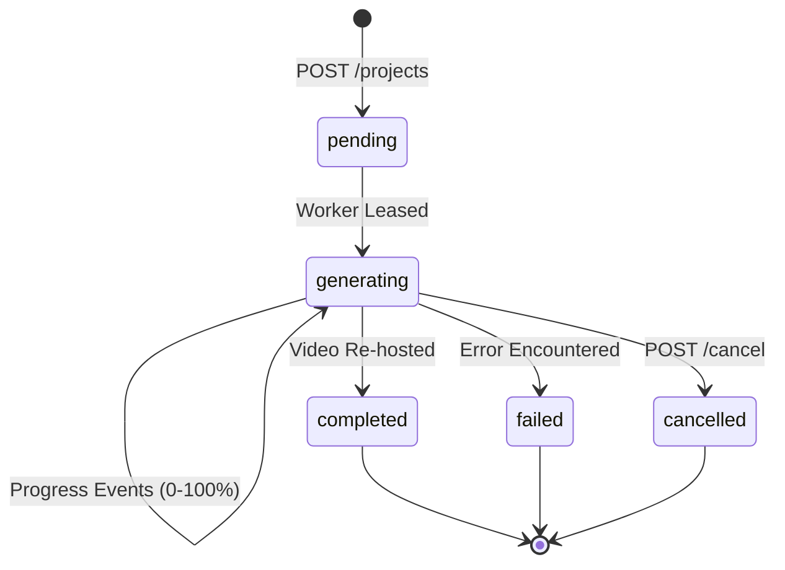

# API Contract — Cretona Backend

**Version:** v1.1 · **Status:** Accepted Baseline · **Base path:** `/api/v1`

This document defines the interface contract between the Android client (`app/`) and the FastAPI backend (`backend/`).

---

## 1. Conventions

### 1.1 Transport & Networking
- HTTPS in production. Development/Emulator uses `http://10.0.2.2:8000` (or `http://<lan-ip>:8000` for physical devices).
- `Content-Type: application/json; charset=utf-8` for standard REST payloads.
- Real-time streams use `text/event-stream` (Server-Sent Events).
- Timestamps are formatted as ISO-8601 UTC (e.g. `2026-08-16T09:14:22Z`).
- Identifiers are UUID v4 strings.

### 1.2 Authentication
All authenticated endpoints require the Supabase JWT bearer token:
```http
Authorization: Bearer <supabase_access_token>
```
The backend verifies the token using JWKS (ES256/HS256) and resolves user identity from the `sub` claim.

| Scenario | HTTP Status | Error Code |
|---|---|---|
| Missing/malformed Authorization header | 401 | `UNAUTHENTICATED` |
| Expired or signature invalid | 401 | `TOKEN_INVALID` |
| Account disabled by admin | 403 | `ACCOUNT_DISABLED` |
| Insufficient role permissions | 403 | `FORBIDDEN` |

### 1.3 Standard Error Envelope
All error responses adhere to the standard JSON envelope:
```json
{
  "error": {
    "code": "VALIDATION_ERROR",
    "message": "Prompt must be between 1 and 1000 characters.",
    "details": [
      { "field": "prompt", "issue": "too_long" }
    ]
  },
  "requestId": "1f0f9c4e-3b2a-4a1e-9c0b-8f3d2e1a7b55"
}
```

### 1.4 Standard Error Codes
`VALIDATION_ERROR` (400), `UNAUTHENTICATED` (401), `TOKEN_INVALID` (401), `ACCOUNT_DISABLED` (403), `FORBIDDEN` (403), `NOT_FOUND` (404), `CONFLICT` (409), `PAYLOAD_TOO_LARGE` (413), `QUOTA_EXCEEDED` (429), `RATE_LIMITED` (429), `PROVIDER_ERROR` (502), `INTERNAL_ERROR` (500).

---

## 2. API Endpoints

### 2.1 Health & Service Info
- **`GET /health`**: Unauthenticated health check.
  - **Response (200)**: `{"status": "ok", "version": "0.1.0"}`

### 2.2 Prompt Enhancer
- **`POST /prompts/enhance`**: Expands raw user prompts using backend text LLMs.
  - **Body**:
    ```json
    { "prompt": "a neon cyberpunk street", "aspectRatio": "16:9" }
    ```
  - **Response (200)**:
    ```json
    {
      "originalPrompt": "a neon cyberpunk street",
      "enhancedPrompt": "Cinematic wide shot of a neon cyberpunk street with rain puddles reflecting holographic signs...",
      "provider": "ollama",
      "usedFallback": false
    }
    ```

### 2.3 User Profile & Quota
- **`GET /me`**: Retrieves caller profile and remaining daily quota.
  - **Response (200)**:
    ```json
    {
      "id": "9f1c2a3d-4b5e-6f70-8192-a3b4c5d6e7f8",
      "email": "user@example.com",
      "username": "khoa",
      "role": "user",
      "isDisabled": false,
      "createdAt": "2026-07-14T02:11:05Z",
      "quota": { "limit": 10, "used": 2, "remaining": 8, "resetsAt": "2026-08-17T00:00:00Z" }
    }
    ```
- **`PATCH /me`**: Updates profile attributes (e.g. username).

### 2.4 Project & Video Generation
- **`POST /projects`**: Submits a new generation job.
  - **Headers**: `Idempotency-Key: <uuid>` (optional but recommended)
  - **Body**:
    ```json
    {
      "title": "Cyberpunk Drone Flight",
      "prompt": "A drone shot flying through a neon-lit cyberpunk city at night",
      "imagePath": null,
      "provider": "fake",
      "options": {
        "durationSeconds": 5,
        "aspectRatio": "16:9",
        "stylePreset": "cyberpunk",
        "cameraMotion": "pan_left"
      }
    }
    ```
  - **Available Options**:
    - `provider`: `"mock"`, `"cloud"`, `"local"`, plus the aliases `"fake"`, `"real"`, `"wan21"`
      (defaults to server default). `mock`↔`fake`, `cloud`/`wan21`↔`real`, `local`↔`local`; the
      stored and returned value is always the canonical `fake`/`real`/`local`.
    - `aspectRatio`: `"9:16"`, `"16:9"`, `"1:1"`.
    - `stylePreset`: `"anime"`, `"cyberpunk"`, `"3d_pixar"`, `"vintage_film"`, `"photorealistic"`.
    - `cameraMotion`: `"pan_left"`, `"pan_right"`, `"zoom_in"`, `"zoom_out"`, `"dolly_zoom"`, `"orbit"`.
  - **Response (201)**: Project Object (§3.1) with `status: "pending"`.

- **`GET /projects`**: Lists current user's projects (cursor paginated, newest first).
  - **Query**: `limit`, `cursor`, `status`.

- **`GET /projects/{id}`**: Retrieves single project state and media URLs.

- **`GET /projects/{id}/events`**: **Real-time Server-Sent Events (SSE)** stream delivering live progress updates.
  - **Response Headers**: `Content-Type: text/event-stream`
  - **Event Data** (`event: project_update`; keyed `id`, not `projectId` — verified against
    `stream_project_events` in `routes.py`):
    ```json
    {
      "id": "3c9a1b2d-…",
      "status": "generating",
      "progressPercent": 65,
      "stepMessage": "Rendering diffusion latent frames...",
      "videoUrl": null,
      "thumbnailUrl": null,
      "errorMessage": null
    }
    ```
    Ends after one `completed` or `failed` event, or after 60 ticks (~90s) at a 1.5s poll
    interval, whichever comes first.

- **`POST /projects/{id}/cancel`**: Cancels an in-flight generation job.
  - **Response (200)**: not a Project Object — `{"cancelled": true, "projectId": "...",
    "quotaRefunded": true}` (`ProjectCancelResponse` in `schemas.py`). The underlying project's
    `status` becomes `"failed"` with `errorMessage: "Generation was cancelled by the user."`;
    `"cancelled"` is never a value of the API's `status` field (`ProjectStatus` only has
    pending/generating/completed/failed). Fetch the project afterward for its state.

- **`POST /projects/{id}/retry`**: Re-queues a failed project.

- **`DELETE /projects/{id}`**: Deletes project record and associated storage assets.

### 2.5 Admin Operations
- **`GET /admin/users`**: List user accounts with cursor pagination, search query `q`, and role filters.
- **`PATCH /admin/users/{id}`**: Update user status (`isDisabled`, `role`).
- **`GET /admin/stats`**: System-wide generation statistics, status distribution, and provider reliability metrics.

---

## 3. Schemas

### 3.1 Project Schema

Verified against `ProjectResponse` in `schemas.py` and how `to_response()` in `project_service.py`
actually populates it — not against the request-time `options` shape, which is a different object
(§2.4). Corrected 2026-08-17: the previous version of this section showed `errorCode` and a nested
`options` object with `stylePreset`/`cameraMotion` that the API has never returned; a live
`GET /projects/{id}` response was diffed against this block to confirm.

```json
{
  "id": "3c9a1b2d-4b5e-6f70-8192-a3b4c5d6e7f8",
  "title": "Cyberpunk Drone Flight",
  "prompt": "A drone shot flying through a neon-lit cyberpunk city at night",
  "imageUrl": null,
  "videoUrl": "https://storage.example.com/videos/3c9a1b2d.mp4?token=...",
  "thumbnailUrl": "https://storage.example.com/videos/3c9a1b2d_thumb.jpg?token=...",
  "status": "completed",
  "provider": "real",
  "errorMessage": null,
  "progressPercent": 100,
  "stepMessage": "Completed",
  "durationSeconds": 5,
  "aspectRatio": "16:9",
  "createdAt": "2026-08-16T09:14:22Z",
  "updatedAt": "2026-08-16T09:16:48Z",
  "completedAt": "2026-08-16T09:16:48Z"
}
```

`stylePreset` and `cameraMotion` are accepted at creation (§2.4) but not echoed back on the
Project Object — they are folded into the stored `prompt` and otherwise not persisted as their
own columns. There is no `errorCode`; `errorMessage` is the only failure signal the API exposes,
and it is the same string regardless of cause (see `FAILURE_MESSAGES` in `project_service.py`) —
a client cannot currently distinguish *why* a project failed from the API response alone.

### 3.2 Status Progression Flow

