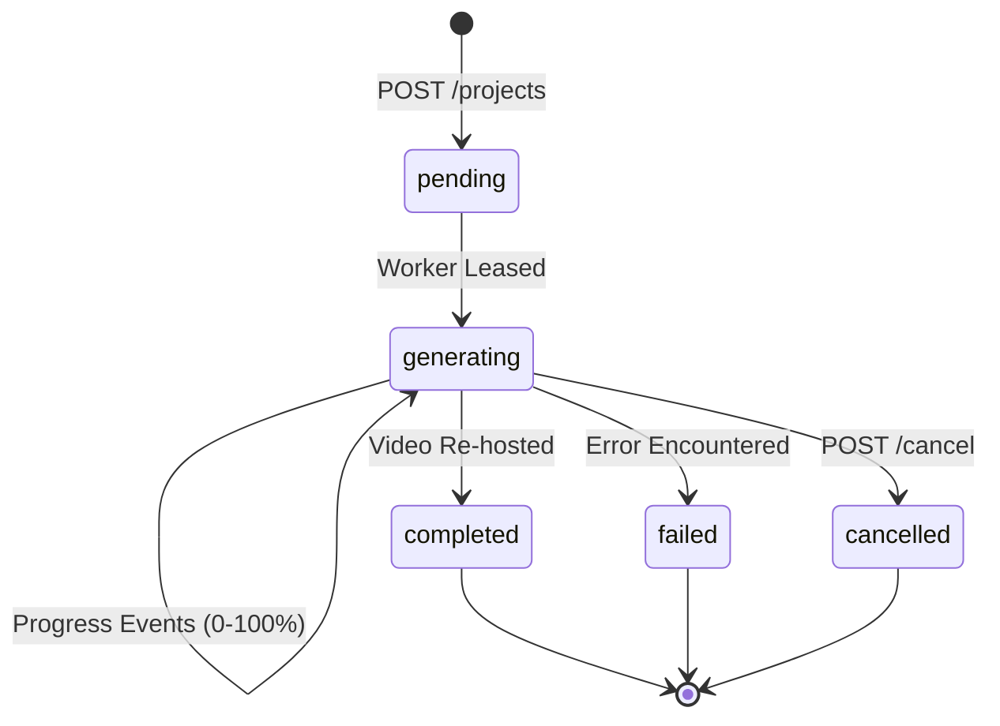

# API Contract — Cretona Backend

**Version:** v1.1 · **Status:** Accepted Baseline · **Base path:** `/api/v1`

This document defines the interface contract between the Android client (`app/`) and the FastAPI backend (`backend/`).

---

## 1. Conventions

### 1.1 Transport & Networking
- HTTPS in production. Development/Emulator uses `http://10.0.2.2:8000` (or `http://<lan-ip>:8000` for physical devices).
- `Content-Type: application/json; charset=utf-8` for standard REST payloads.
- Real-time streams use `text/event-stream` (Server-Sent Events).
- Timestamps are formatted as ISO-8601 UTC (e.g. `2026-08-16T09:14:22Z`).
- Identifiers are UUID v4 strings.

### 1.2 Authentication
All authenticated endpoints require the Supabase JWT bearer token:
```http
Authorization: Bearer <supabase_access_token>
```
The backend verifies the token using JWKS (ES256/HS256) and resolves user identity from the `sub` claim.

| Scenario | HTTP Status | Error Code |
|---|---|---|
| Missing/malformed Authorization header | 401 | `UNAUTHENTICATED` |
| Expired or signature invalid | 401 | `TOKEN_INVALID` |
| Account disabled by admin | 403 | `ACCOUNT_DISABLED` |
| Insufficient role permissions | 403 | `FORBIDDEN` |

### 1.3 Standard Error Envelope
All error responses adhere to the standard JSON envelope:
```json
{
  "error": {
    "code": "VALIDATION_ERROR",
    "message": "Prompt must be between 1 and 1000 characters.",
    "details": [
      { "field": "prompt", "issue": "too_long" }
    ]
  },
  "requestId": "1f0f9c4e-3b2a-4a1e-9c0b-8f3d2e1a7b55"
}
```

### 1.4 Standard Error Codes
`VALIDATION_ERROR` (400), `UNAUTHENTICATED` (401), `TOKEN_INVALID` (401), `ACCOUNT_DISABLED` (403), `FORBIDDEN` (403), `NOT_FOUND` (404), `CONFLICT` (409), `PAYLOAD_TOO_LARGE` (413), `QUOTA_EXCEEDED` (429), `RATE_LIMITED` (429), `PROVIDER_ERROR` (502), `INTERNAL_ERROR` (500).

---

## 2. API Endpoints

### 2.1 Health & Service Info
- **`GET /health`**: Unauthenticated health check.
  - **Response (200)**: `{"status": "ok", "version": "0.1.0"}`

### 2.2 Prompt Enhancer
- **`POST /prompts/enhance`**: Expands raw user prompts using backend text LLMs.
  - **Body**:
    ```json
    { "prompt": "a neon cyberpunk street", "aspectRatio": "16:9" }
    ```
  - **Response (200)**:
    ```json
    {
      "originalPrompt": "a neon cyberpunk street",
      "enhancedPrompt": "Cinematic wide shot of a neon cyberpunk street with rain puddles reflecting holographic signs...",
      "provider": "ollama",
      "usedFallback": false
    }
    ```

### 2.3 User Profile & Quota
- **`GET /me`**: Retrieves caller profile and remaining daily quota.
  - **Response (200)**:
    ```json
    {
      "id": "9f1c2a3d-4b5e-6f70-8192-a3b4c5d6e7f8",
      "email": "user@example.com",
      "username": "khoa",
      "role": "user",
      "isDisabled": false,
      "createdAt": "2026-07-14T02:11:05Z",
      "quota": { "limit": 10, "used": 2, "remaining": 8, "resetsAt": "2026-08-17T00:00:00Z" }
    }
    ```
- **`PATCH /me`**: Updates profile attributes (e.g. username).

### 2.4 Project & Video Generation
- **`POST /projects`**: Submits a new generation job.
  - **Headers**: `Idempotency-Key: <uuid>` (optional but recommended)
  - **Body**:
    ```json
    {
      "title": "Cyberpunk Drone Flight",
      "prompt": "A drone shot flying through a neon-lit cyberpunk city at night",
      "imagePath": null,
      "provider": "fake",
      "options": {
        "durationSeconds": 5,
        "aspectRatio": "16:9",
        "stylePreset": "cyberpunk",
        "cameraMotion": "pan_left"
      }
    }
    ```
  - **Available Options**:
    - `provider`: `"mock"`, `"cloud"`, `"local"`, plus the aliases `"fake"`, `"real"`, `"wan21"`
      (defaults to server default). `mock`↔`fake`, `cloud`/`wan21`↔`real`, `local`↔`local`; the
      stored and returned value is always the canonical `fake`/`real`/`local`.
    - `aspectRatio`: `"9:16"`, `"16:9"`, `"1:1"`.
    - `stylePreset`: `"anime"`, `"cyberpunk"`, `"3d_pixar"`, `"vintage_film"`, `"photorealistic"`.
    - `cameraMotion`: `"pan_left"`, `"pan_right"`, `"zoom_in"`, `"zoom_out"`, `"dolly_zoom"`, `"orbit"`.
  - **Response (201)**: Project Object (§3.1) with `status: "pending"`.

- **`GET /projects`**: Lists current user's projects (cursor paginated, newest first).
  - **Query**: `limit`, `cursor`, `status`.

- **`GET /projects/{id}`**: Retrieves single project state and media URLs.

- **`GET /projects/{id}/events`**: **Real-time Server-Sent Events (SSE)** stream delivering live progress updates.
  - **Response Headers**: `Content-Type: text/event-stream`
  - **Event Data** (`event: project_update`; keyed `id`, not `projectId` — verified against
    `stream_project_events` in `routes.py`):
    ```json
    {
      "id": "3c9a1b2d-…",
      "status": "generating",
      "progressPercent": 65,
      "stepMessage": "Rendering diffusion latent frames...",
      "videoUrl": null,
      "thumbnailUrl": null,
      "errorMessage": null
    }
    ```
    Ends after one `completed` or `failed` event, or after 60 ticks (~90s) at a 1.5s poll
    interval, whichever comes first.

- **`POST /projects/{id}/cancel`**: Cancels an in-flight generation job.
  - **Response (200)**: not a Project Object — `{"cancelled": true, "projectId": "...",
    "quotaRefunded": true}` (`ProjectCancelResponse` in `schemas.py`). The underlying project's
    `status` becomes `"failed"` with `errorMessage: "Generation was cancelled by the user."`;
    `"cancelled"` is never a value of the API's `status` field (`ProjectStatus` only has
    pending/generating/completed/failed). Fetch the project afterward for its state.

- **`POST /projects/{id}/retry`**: Re-queues a failed project.

- **`DELETE /projects/{id}`**: Deletes project record and associated storage assets.

### 2.5 Admin Operations
- **`GET /admin/users`**: List user accounts with cursor pagination, search query `q`, and role filters.
- **`PATCH /admin/users/{id}`**: Update user status (`isDisabled`, `role`).
- **`GET /admin/stats`**: System-wide generation statistics, status distribution, and provider reliability metrics.

---

## 3. Schemas

### 3.1 Project Schema

Verified against `ProjectResponse` in `schemas.py` and how `to_response()` in `project_service.py`
actually populates it — not against the request-time `options` shape, which is a different object
(§2.4). Corrected 2026-08-17: the previous version of this section showed `errorCode` and a nested
`options` object with `stylePreset`/`cameraMotion` that the API has never returned; a live
`GET /projects/{id}` response was diffed against this block to confirm.

```json
{
  "id": "3c9a1b2d-4b5e-6f70-8192-a3b4c5d6e7f8",
  "title": "Cyberpunk Drone Flight",
  "prompt": "A drone shot flying through a neon-lit cyberpunk city at night",
  "imageUrl": null,
  "videoUrl": "https://storage.example.com/videos/3c9a1b2d.mp4?token=...",
  "thumbnailUrl": "https://storage.example.com/videos/3c9a1b2d_thumb.jpg?token=...",
  "status": "completed",
  "provider": "real",
  "errorMessage": null,
  "progressPercent": 100,
  "stepMessage": "Completed",
  "durationSeconds": 5,
  "aspectRatio": "16:9",
  "createdAt": "2026-08-16T09:14:22Z",
  "updatedAt": "2026-08-16T09:16:48Z",
  "completedAt": "2026-08-16T09:16:48Z"
}
```

`stylePreset` and `cameraMotion` are accepted at creation (§2.4) but not echoed back on the
Project Object — they are folded into the stored `prompt` and otherwise not persisted as their
own columns. There is no `errorCode`; `errorMessage` is the only failure signal the API exposes,
and it is the same string regardless of cause (see `FAILURE_MESSAGES` in `project_service.py`) —
a client cannot currently distinguish *why* a project failed from the API response alone.

### 3.2 Status Progression Flow


---

# Part II — Credits, Events and Generation Modes

- **Added:** 2026-08-28 · **Status:** **implemented and green** as of
  2026-08-28. Every endpoint below exists; 590 backend tests pass against
  both SQLite and Postgres with 0 skipped.
- **Owners:** S0ra1n0 implements the server; Bruce codes Android against this
  document from day 1 with a fake repository implementation.
- **Rule:** this document is the source of truth. A change here is told to the
  other developer the same day. Contract drift found on 09-03 is the failure
  this exists to prevent.

## 4. Conventions that apply to everything below

1. **Wire casing is camelCase.** Python keeps snake_case and aliases at the
   schema boundary, exactly as `MeResponse` already does.
2. **Errors use the §1.3 envelope.** New codes are listed in §4.1. A new
   endpoint that returns a bare status string is a bug — `toAppError()` parses
   the envelope, and the user sees a raw HTTP code otherwise.
3. **Optional request fields carry no Kotlin default value.** `explicitNulls =
   false` drops nulls and `encodeDefaults = false` drops anything equal to its
   default, so a field with a default is silently unsendable. This is the
   `gender`/`birthday` bug; `MeUpdateRequestSerializationTest` pins it. Every
   new request model with an optional field needs the same treatment and the
   same test.
4. **Money is an integer of VND.** No decimals, no floats, no currency string.
5. **Timestamps are ISO-8601 UTC with `Z`.** The client converts for display.
6. **Cursor pagination**, same shape as `GET /projects`:
   `{ "items": [...], "nextCursor": "<opaque|null>" }`. Query: `?limit=20&cursor=`.
7. **`Idempotency-Key: <uuid>`** is required on every endpoint that moves
   credits. Replaying a key returns the original result and never charges or
   grants twice.

### 4.1 New error codes

| Code | HTTP | Meaning | Android behaviour |
|---|---:|---|---|
| `INSUFFICIENT_CREDITS` | 402 | Balance below the cost of this generation | Route to the Credits screen; never show a raw error |
| `EVENT_NOT_ACTIVE` | 409 | Event window closed, or not started | Refresh the event list |
| `EVENT_ALREADY_CLAIMED` | 409 | Already claimed for this period | Show "claimed", disable the button |
| `EVENT_FULL` | 409 | Global claim cap reached | Show "fully claimed" |
| `PACKAGE_INACTIVE` | 409 | Package disabled between listing and purchase | Refresh packages |

`QUOTA_EXCEEDED` (429) keeps its current meaning — the rolling rate limit. It is
**not** reused for credits. The two are independent controls.

---

## 5. Generation modes

The app supports three input modes. Both fields are individually optional;
**at least one must be present**.

| Mode | `prompt` | `imagePath` | Meaning |
|---|:--:|:--:|---|
| `text` | yes | — | Text-to-video |
| `image` | — | yes | Image-to-video, no text guidance |
| `text_image` | yes | yes | Image-to-video guided by the prompt |

- The client **does not send `mode`.** The server derives it and returns it on
  every project object, so the two can never disagree.
- Missing both → `VALIDATION_ERROR` with
  `details: [{ "field": "prompt", "issue": "prompt_or_image_required" }]`.
- The server picks the model from the mode. Which model serves `image` and
  `text_image` is a provider concern and is **not** exposed to Android — this
  preserves ADR-009's provider neutrality.
- If no image-capable provider is available the request fails with
  `PROVIDER_ERROR`. It does **not** silently fall back to text-only: a user who
  supplied an image and received a video that ignores it has been misled.
- **Implemented as a provider attribute**, `supports_image`. `real` and `local`
  are True (they pan across the account's own upload, W4); `fake` and `kaggle`
  are False. When an image-conditioned model is proven (D1 / EXP-005), that
  attribute is the line that changes.
- Ownership of the image path is checked **before** capability, so the status
  code cannot be used to probe whether someone else's storage path exists.

`POST /projects` gains no new request fields. `prompt` becomes nullable, and the
project response object gains `"mode"`.

---

## 6. Credits — user endpoints

### 6.1 `GET /me/credits`

```json
{
  "balance": 25,
  "generationCost": 1,
  "effectiveCost": 1,
  "activeDiscount": null,
  "lifetimeGranted": 35,
  "lifetimeSpent": 10
}
```

`generationCost` is the configured base cost, set by an admin through
`PATCH /admin/settings`. `effectiveCost` is what the next generation actually
costs **right now**, after any active discount event — resolved server-side at
request time and again at charge time, so a stale client number can never
decide a price. While a discount runs:

```json
{
  "balance": 25,
  "generationCost": 2,
  "effectiveCost": 1,
  "activeDiscount": {
    "eventId": "3f2a…", "name": "Hot Hours", "discountPercent": 50,
    "endsAt": "2026-08-28T15:00:00Z"
  },
  "lifetimeGranted": 35,
  "lifetimeSpent": 10
}
```

The Create screen shows `effectiveCost`, never `generationCost`. A non-null
`activeDiscount` is what drives the "50% off until 22:00" banner.

### 6.2 `GET /me/credits/transactions?limit=20&cursor=`

```json
{
  "items": [
    {
      "id": "8a1c…",
      "delta": -1,
      "balanceAfter": 24,
      "reason": "generation",
      "refType": "project",
      "refId": "b72f…",
      "note": "Hot Hours -50%",
      "createdAt": "2026-08-28T13:20:11Z"
    }
  ],
  "nextCursor": null
}
```

`reason` is one of `signup_bonus`, `event_grant`, `purchase`, `generation`,
`refund`, `admin_adjustment`. Android maps each to a label and an icon; an
unrecognised value renders as the raw string rather than crashing, because the
server may add reasons later.

---

## 7. Events — the promotion system

One table serves every case. An event is either a **grant** (gives credits) or a
**discount** (reduces generation cost), and fires **once**, **daily**, or
**weekly** inside its campaign window.

| Wanted behaviour | `kind` | `recurrence` | Fields |
|---|---|---|---|
| Hot hours, −50% from 20:00–22:00 | `discount` | `daily` | `discountPercent: 50`, `activeFromMinute: 1200`, `activeToMinute: 1320` |
| Weekend gift, +10 credits | `grant` | `weekly` | `bonusCredits: 10`, `activeDays: ["sat","sun"]` |
| National Day gift | `grant` | `once` | `bonusCredits: 20`, window = the holiday |
| Admin surprise drop | `grant` | `once` | created ad hoc, short window |
| Signup bonus | `grant` | `once` | `autoGrant: true` — applied at registration, no user action |

**Minutes are local Vietnam time (UTC+7)**, stored as minutes from midnight.
`1200` is 20:00, `1320` is 22:00. The server does the conversion; the client
never computes a window.

### 7.1 `GET /events`

Events that are live or upcoming, with per-caller claim state.

```json
{
  "items": [
    {
      "id": "e1…",
      "code": "HOT_HOURS",
      "name": "Hot Hours",
      "description": "Half price on every generation, 20:00–22:00 daily.",
      "kind": "discount",
      "discountPercent": 50,
      "bonusCredits": null,
      "recurrence": "daily",
      "isActiveNow": true,
      "activeUntil": "2026-08-28T15:00:00Z",
      "nextActiveAt": null,
      "claimable": false,
      "claimedThisPeriod": false,
      "remainingSlots": null
    },
    {
      "id": "e2…",
      "code": "WEEKEND_GIFT",
      "name": "Weekend Gift",
      "description": "+10 credits every weekend.",
      "kind": "grant",
      "discountPercent": null,
      "bonusCredits": 10,
      "recurrence": "weekly",
      "isActiveNow": false,
      "activeUntil": null,
      "nextActiveAt": "2026-08-29T17:00:00Z",
      "claimable": false,
      "claimedThisPeriod": false,
      "remainingSlots": 480
    }
  ],
  "nextCursor": null
}
```

- **`claimable` is the single flag the button binds to.** True only when the
  event is a `grant`, is active now, has slots left, and the caller has not
  claimed it this period. Android must not re-derive this from the other
  fields — the server owns the rule, and it is the one place a bug would give
  away credits.
- **`discount` events are never claimable.** They apply automatically at charge
  time. The card shows them as information.
- `remainingSlots` is `null` for uncapped events.

### 7.2 `POST /events/{id}/claim`

Header `Idempotency-Key` required. Empty body.

```json
{ "creditsGranted": 10, "balance": 35, "transactionId": "c93a…" }
```

Failures use the §4.1 codes: `EVENT_NOT_ACTIVE`, `EVENT_ALREADY_CLAIMED`,
`EVENT_FULL`.

**The cap and the per-period uniqueness are enforced in SQL**, not by reading a
count and then inserting. A double-tap on a phone is enough to race a
read-then-write and grant twice. `event_claims` carries
`unique (event_id, user_id, period_key)`, where `period_key` is `''` for `once`,
the local date for `daily`, and the ISO week for `weekly`.

---

## 8. Credit packages and payments

Retained deliberately. §2.2 requires "chức năng mua thêm Credit", §3 requires a
credit-package API and revenue reporting, and §5 names `Credit Packages` and
`Payments` as required tables. Events do not satisfy those lines.

**No real money moves.** See `ADR-010`. The flow, the state machine, the
idempotency and the ledger entry are all real; only the gateway confirmation is
stubbed.

### 8.1 `GET /credit-packages`

```json
{ "items": [
  { "id": "p1…", "name": "Starter", "credits": 10, "priceVnd": 20000, "sortOrder": 1 },
  { "id": "p2…", "name": "Creator", "credits": 50, "priceVnd": 90000, "sortOrder": 2 }
] }
```

### 8.2 `POST /payments`

Header `Idempotency-Key` required.

```json
{ "packageId": "p1…" }
```

Response `201`:

```json
{
  "id": "pay1…", "status": "completed",
  "packageId": "p1…", "amountVnd": 20000,
  "creditsGranted": 10, "balance": 35,
  "method": "simulated",
  "createdAt": "2026-08-28T13:20:11Z",
  "completedAt": "2026-08-28T13:20:11Z"
}
```

The payment row and the credit transaction are written in **one database
transaction**. A completed payment that granted no credits, or credits granted
with no payment row, is a bug the tests must cover.

---

## 9. Admin endpoints

All require the admin role and are audit-logged through the existing
`AuditEntry` mechanism, written in the same transaction as the mutation.

| Method | Path | Body / notes |
|---|---|---|
| `POST` | `/admin/users/{id}/credits` | `{ "delta": 25, "note": "compensation" }` → reason `admin_adjustment`. Rejects a delta that would drive the balance negative |
| `GET` | `/admin/credit-transactions` | `?userId=&reason=&limit=&cursor=` |
| `GET` `POST` `PATCH` | `/admin/credit-packages` | `PATCH` toggles `isActive`. Packages are never deleted — payments reference them |
| `GET` `POST` `PATCH` | `/admin/events` | The full event shape from §7, plus `isActive` |
| `GET` | `/admin/events/{id}/claims` | Who claimed, when, how much |
| `GET` | `/admin/payments` | `?status=&limit=&cursor=` |
| `GET` `PATCH` | `/admin/settings` | `{ "generationCostCredits": 1 }` — closes the §3 "cấu hình chi phí tạo video" line |
| `GET` | `/admin/projects` | `?status=&userId=&limit=&cursor=` — list and moderate videos |
| `GET` | `/admin/credits/drift` | Accounts whose cached balance disagrees with their ledger. The only symptom a silently failed refund has |

### 9.1 `GET /admin/stats` — extended

Four of the six metrics §3 requires are missing today. Existing keys are
unchanged; these are added:

```json
{
  "totals": { "users": 42, "activeUsers": 30, "projects": 128,
              "creditsGranted": 1420, "creditsUsed": 380, "revenueVnd": 1800000 },
  "daily": [ { "date": "2026-08-28", "created": 12, "completed": 10, "failed": 2,
               "newUsers": 3, "creditsGranted": 40, "creditsUsed": 12,
               "revenueVnd": 90000 } ],
  "events": [ { "eventId": "e2…", "code": "WEEKEND_GIFT", "name": "Weekend Gift",
                "claims": 37, "creditsGranted": 370, "remainingSlots": 463 } ]
}
```

`newUsers` counts signups. `created` counts projects, which is a different
number and does not satisfy the "User mới" line.

The daily series is assembled from **four separate queries** merged by date, not
one joined query. A join would drop any day on which credits moved but no
project was created, and a revenue chart with holes in it is worse than no
chart because it looks like data.

---

## 10. Charging rules

Normative. `CreditService` is the only writer of a balance.

1. **Reserve at submit.** `POST /projects` charges `effectiveCost` before the
   provider is called. The brief allows charge-on-success or
   charge-then-refund; reserving is the only option that stops a user with one
   credit launching ten jobs.
2. **`effectiveCost = max(1, round(baseCost × (100 − discountPercent) / 100))`**,
   computed server-side at charge time from the events active at that instant.
   A discount that expires between the client rendering the screen and the
   request arriving charges full price — the client's number is an estimate,
   the server's is the truth.
3. **Insufficient balance → `402 INSUFFICIENT_CREDITS`** before any provider
   call, any row insert, or any quota consumption.
4. **Refund on `failed` and on `cancelled`.** The amount actually charged, read
   back from the original transaction — never recomputed, because the discount
   may have ended since. Reason `refund`, same `refId`.
5. **Retry charges again.** It is a real generation, matching ADR-007's existing
   treatment of retry.
6. **Idempotent.** `credit_transactions` carries
   `unique (user_id, idempotency_key)` where the key is not null. A replayed
   submit returns the original project and does not charge twice.
7. **The ledger is append-only.** `users.credit_balance` is a cache written in
   the same transaction. `balanceAfter` on every row exists so drift is
   detectable by a query rather than by a user complaint.
