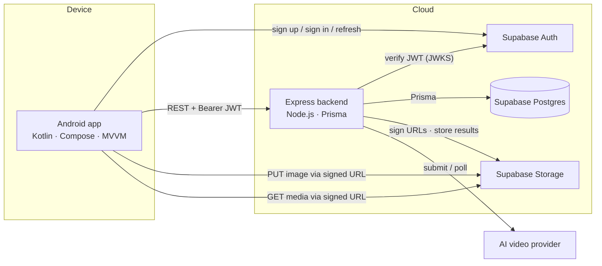
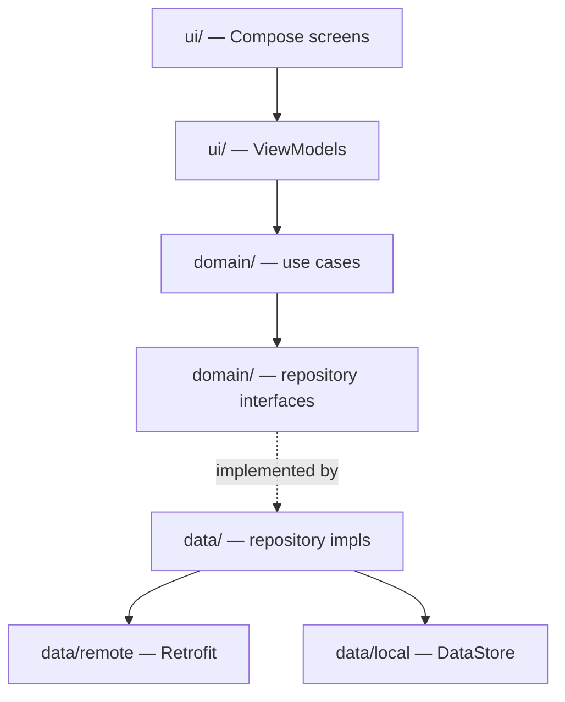

# Architecture — Cretona

**Version:** 0.1 · **Status:** Draft

---

## 1. System Overview



### Why the app talks to Supabase Auth directly
Auth is the one place where reimplementing the flow in the backend buys nothing: the Supabase SDK already handles sign-up, sign-in, token refresh, and secure session persistence. The backend only needs to *verify* the resulting JWT. This removes a whole class of credential-handling code from our own server. See [ADR-002](adr/ADR-002-auth-strategy.md).

### Why generation goes through the backend
The opposite reasoning applies to provider calls. Provider keys must never reach the device (NFR-2.5), quota and cost control must be server-enforced (FR-5.1), and results need re-hosting because provider URLs expire (C-3). All of that requires a trusted server between the app and the provider.

---

## 2. Repository Layout

The repo is a monorepo whose **root is the Android Gradle project**, so `Cretona/` opens directly in Android Studio and syncs without extra configuration ([ADR-001](adr/ADR-001-repo-layout.md)).

```text
Cretona/
├── app/                        Android application module
│   └── src/main/java/com/cretona/app/
│       ├── core/               cross-cutting (result types, network plumbing)
│       ├── data/               DTOs, Retrofit services, repository implementations
│       ├── domain/             models and use cases, no Android imports
│       ├── di/                 Hilt modules
│       └── ui/                 Compose screens, ViewModels, theme, navigation
├── backend/                    Express + Prisma service (Phase 2)
├── docs/                       this documentation set
├── gradle/                     version catalog + wrapper
├── build.gradle.kts            root Gradle build
└── settings.gradle.kts
```

Android Studio indexes `backend/` as plain files and ignores it during Gradle sync.

---

## 3. Android Architecture

### 3.1 Layers



**Dependency rule:** `ui → domain ← data`. `domain` imports nothing from Android or from `data`. Repository *interfaces* live in `domain`; their implementations live in `data` and are bound with Hilt. This is what makes ViewModels unit-testable without Robolectric.

### 3.2 State and events

Each screen has one immutable UI state exposed as `StateFlow<XxxUiState>`, collected with `collectAsStateWithLifecycle()`. Loading, empty, error, and content are states of that object — not scattered booleans (NFR-4.1).

```kotlin
data class HistoryUiState(
    val items: List<ProjectSummary> = emptyList(),
    val isLoading: Boolean = false,
    val error: UiText? = null,
    val filter: ProjectStatus? = null,
)
```

One-shot effects (navigation, snackbars) go through a separate `Channel`/`SharedFlow` so they are not replayed on configuration change.

### 3.3 Error handling

Nothing above `data` sees an exception. Repositories return `AppResult<T>` (`core/result/AppResult.kt`), and HTTP failures are mapped to `AppError` by response code and the backend's `error.code` field. ViewModels turn `AppError` into user-facing text (NFR-4.2).

### 3.4 Generation status

The Android side treats generation as a long-running background fact, not a screen-scoped operation:

- Submitting returns immediately with a `pending` project.
- A repository-level poller drives `GET /projects/:id` on the schedule in API_CONTRACT §4 and emits updates as a `Flow`.
- Polling is lifecycle-aware: it stops when the app backgrounds and resumes on foreground. The server keeps working either way, so nothing is lost.

### 3.5 Media

- **Images:** Coil 3 with the shared OkHttp client, so signed-URL requests reuse the same connection pool and interceptors.
- **Video:** Media3/ExoPlayer, with the player instance held by the ViewModel and released in `onCleared`.
- **Signed URLs:** always fetched fresh before playback or download (API_CONTRACT §3.1) and never persisted to DataStore.

### 3.6 Dependency injection

Hilt with KSP. `SingletonComponent` provides `Json`, `OkHttpClient`, `Retrofit`, API services, and repositories. `ViewModelComponent` provides use cases. `@HiltViewModel` + `hiltViewModel()` in Compose.

---

## 4. Backend Architecture

```text
backend/src/
├── routes/          HTTP routing only — no logic
├── controllers/     parse request → call service → shape response
├── middleware/      auth, rbac, rate limit, validation, error handler, request id
├── services/
│   ├── projects/    project lifecycle and state transitions
│   ├── quota/       quota accounting
│   ├── storage/     signed URLs, re-hosting, deletion
│   └── ai/          provider interface, registry, implementations
├── jobs/            poller / worker loop
├── prisma/          schema + migrations
└── utils/           logging, errors, redaction
```

**Rules that keep this maintainable (NFR-5.3):**
- Controllers contain no business logic and no Prisma calls.
- Only `services/projects` may write `video_projects.status`; the legal-transition check lives in one function.
- Only `services/ai` knows a provider exists. Everything above it deals in the normalized interface.

### 4.1 Request pipeline

```
requestId → logger → rateLimit → authenticate(JWT) → loadUser → rejectIfDisabled
  → authorize(role) → validate(schema) → controller → service → errorHandler
```

`rejectIfDisabled` sits deliberately before authorization so a disabled admin is stopped too (FR-1.8).

### 4.2 The job runner

A single interval worker claims due jobs with `SELECT … FOR UPDATE SKIP LOCKED`, so running more than one backend instance does not double-poll a job. For each claimed project it asks the provider for status and then:

| Provider says | Action |
|---|---|
| still running | update `updated_at`, leave `generating` |
| succeeded | download result → upload to `videos` bucket → `completed` |
| failed | map to a user-readable message → `failed` |
| unreachable / 5xx | retry with backoff up to 3 attempts (NFR-3.2) |
| past timeout | `failed` with a timeout message (NFR-3.3) |

Because state lives entirely in Postgres, a backend restart resumes cleanly (NFR-3.1). Webhooks can later replace the polling trigger without changing any of the transition logic.

---

## 5. Cross-Cutting Concerns

| Concern | Approach |
|---|---|
| **Config** | All config from environment; validated at boot, process exits on missing required keys. Android reads per-machine values from `local.properties` into `BuildConfig`. |
| **Secrets** | Provider keys and `service_role` exist only in backend env. The app holds only the Supabase URL and anon key. See [SECURITY.md](SECURITY.md). |
| **Logging** | Structured JSON with `requestId`, `userId`, `projectId`. Authorization headers and API keys redacted at the logger, not at call sites. |
| **Idempotency** | `Idempotency-Key` on submit, backed by a partial unique index (DATA_MODEL §2.3). |
| **Time** | UTC everywhere; formatting for display happens in the UI layer only. |

---

## 6. Known Trade-offs

| Decision | Cost we accept | Why |
|---|---|---|
| Polling instead of webhooks for MVP | Extra provider API calls; up to one poll-interval of latency | No public URL or signature handling needed to get the pipeline working end to end. Revisit at scale ([ADR-003](adr/ADR-003-async-strategy.md)) |
| Interval worker in the API process | Won't scale past a few hundred concurrent jobs | A queue (BullMQ/Redis) is a drop-in later; the claim query is already concurrency-safe |
| Single Android module | Slower incremental builds as the app grows | Module splitting is a mechanical refactor once the package boundaries above are respected |
| Denormalized `email` on `users` | Must stay in sync with `auth.users` | Admin search would otherwise need a cross-schema join on every keystroke |
