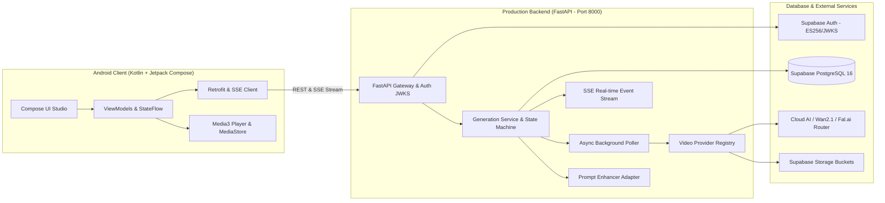
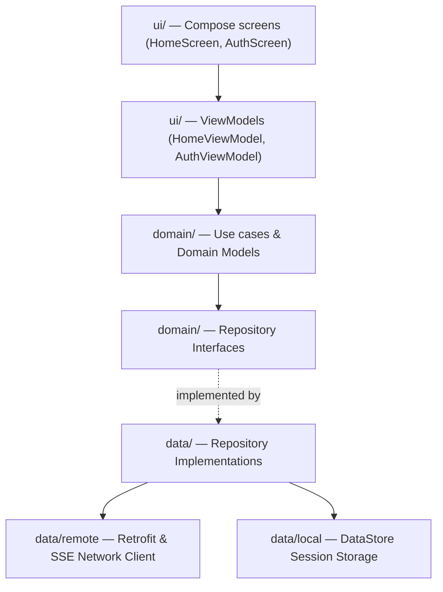

# Architecture — Cretona

**Version:** 1.0 · **Status:** Accepted Baseline · **Last updated:** 2026-08-16

---

## 1. System Architecture Overview



### 1.1 Key Architectural Decisions
1. **Direct Auth Token Verification**: The Android app signs in directly with Supabase Auth. The FastAPI backend verifies the resulting ES256/HS256 JWT against Supabase's JWKS endpoint ([ADR-002](adr/ADR-002-auth-strategy.md)).
2. **Server-Side AI Gateway**: AI provider API keys, model endpoints, and secret tokens never touch the client ([NFR-SEC-001](SRS.md)). The backend enforces daily rolling quotas, manages async job polling leases, and saves permanent media copies to Supabase Storage before returning signed URLs.
3. **Reactive Real-Time Streaming**: Live generation status and progress percentages (0–100%) are streamed via Server-Sent Events (SSE) from `GET /api/v1/projects/{id}/events`, delivering an instantaneous, fluid UX on mobile.

---

## 2. Repository Structure

Cretona uses a unified monorepo whose **root is the Android Gradle project**:

```text
Cretona/
├── app/                        Android application module (Kotlin 2.3 + Jetpack Compose)
│   └── src/main/java/com/cretona/app/
│       ├── core/               Base utilities, network interceptors, Result models
│       ├── data/               DTOs, Retrofit services, Repository implementations
│       ├── domain/             Pure Kotlin domain models, Repository interfaces
│       ├── di/                 Dagger Hilt dependency injection modules
│       └── ui/                 Compose screens (HomeScreen, AuthScreen), ViewModels
├── backend/                    Production FastAPI backend (Python 3.12)
│   ├── app/                    API routers, schemas, services, providers, database
│   ├── tests/                  Unit & integration test suite (302 tests passing)
│   ├── pyproject.toml          Python package & dependencies configuration
│   └── README.md
├── docs/                       Architecture, SRS, API Contract, Data Model, Roadmaps
├── gradle/                     Gradle version catalog & wrapper
├── scripts/                    Setup & execution scripts (`run-fastapi.ps1`, etc.)
├── supabase/                   PostgreSQL migration files (001 - 009)
├── build.gradle.kts            Root Android build configuration
└── settings.gradle.kts
```

---

## 3. Android Client Architecture

### 3.1 Layering & Dependency Inversion


- **Clean Layering:** `ui → domain ← data`. The `domain` layer has 0 Android dependencies, ensuring pure testability.
- **State Management:** Screens observe immutable `StateFlow<HomeUiState>` via Compose lifecycle-aware collectors.
- **Media Engine:** Video playback uses `androidx.media3:media3-exoplayer`. Downloads directly write MP4 binaries into `MediaStore.Video.Media` with primary external volume scoping.
- **Sharing Engine:** Social exports utilize `androidx.core.content.FileProvider` to deliver secure content URIs to external applications without granting broad file system access.

---

## 4. Backend Architecture & Pipeline

### 4.1 State Machine
Project lifecycle transitions are governed strictly by `backend/app/transitions.py`:
- `pending` $\rightarrow$ `generating` $\rightarrow$ `completed` | `failed` | `cancelled`.
- Leased worker polling ensures at-most-once processing and prevents race conditions under scale.

### 4.2 Multi-Provider Adapters
- `FakeVideoProvider`: Zero-spend mock provider for lightning-fast testing and offline demonstrations.
- `RealAiVideoProvider`: Cloud AI router adapter for production APIs.
- `Wan21VideoProvider`: Adapter for Alibaba's Wan 2.1 open diffusion model.
