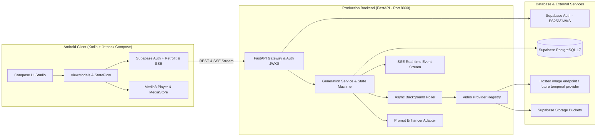
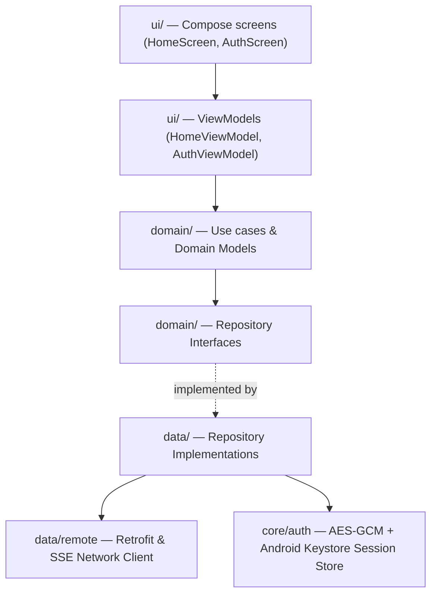

# Architecture — Cretona

**Version:** 1.1 · **Status:** Implemented Baseline · **Last updated:** 2026-08-20

---

## 1. System Architecture Overview



### 1.1 Key Architectural Decisions
1. **Direct Auth Token Verification**: The Android app signs in directly with Supabase Auth. The FastAPI backend verifies the resulting ES256/HS256 JWT against Supabase's JWKS endpoint ([ADR-002](adr/ADR-002-auth-strategy.md)).
2. **Server-Side AI Gateway**: AI provider API keys, model endpoints, and secret tokens never touch the client ([NFR-SEC-001](SRS.md)). The backend enforces daily rolling quotas, manages async job polling leases, and saves permanent media copies to Supabase Storage before returning signed URLs.
3. **Progress Boundary**: FastAPI exposes Server-Sent Events at `GET /api/v1/projects/{id}/events`. The current Android integration uses bounded REST polling; direct Android SSE consumption remains a future optimization and must not be presented as implemented.

---

## 2. Repository Structure

Cretona uses a unified monorepo whose **root is the Android Gradle project**:

```text
Cretona/
├── app/                        Android application module (Kotlin 2.4.10 + Jetpack Compose)
│   └── src/main/java/com/cretona/app/
│       ├── core/               Base utilities, network interceptors, Result models
│       ├── data/               DTOs, Retrofit services, Repository implementations
│       ├── domain/             Pure Kotlin domain models, Repository interfaces
│       ├── di/                 Dagger Hilt dependency injection modules
│       └── ui/                 Compose screens (HomeScreen, AuthScreen), ViewModels
├── backend/                    Production FastAPI backend (Python 3.12)
│   ├── app/                    API routers, schemas, services, providers, database
│   ├── tests/                  Unit & integration suite (365 default + 31 Postgres gates)
│   ├── pyproject.toml          Python package & dependencies configuration
│   └── README.md
├── docs/                       Architecture, SRS, API Contract, Data Model, Roadmaps
├── gradle/                     Gradle version catalog & wrapper
├── scripts/                    Setup & execution scripts (`run-fastapi.ps1`, etc.)
├── supabase/                   PostgreSQL migration files (002 - 012 plus bootstrap)
├── build.gradle.kts            Root Android build configuration
└── settings.gradle.kts
```

---

## 3. Android Client Architecture

### 3.1 Layering & Dependency Inversion


- **Clean Layering:** `ui → domain ← data`. The `domain` layer has 0 Android dependencies, ensuring pure testability.
- **State Management:** Screens observe immutable `StateFlow<HomeUiState>` via Compose lifecycle-aware collectors.
- **Session ownership:** `supabase-kt` owns refresh rotation; a custom SDK
  `SessionManager` persists only authenticated ciphertext and the startup route
  waits for initialization before entering the app.
- **Media Engine:** Video playback uses `androidx.media3:media3-exoplayer`. Downloads directly write MP4 binaries into `MediaStore.Video.Media` with primary external volume scoping.
- **Sharing Engine:** Social exports utilize `androidx.core.content.FileProvider` to deliver secure content URIs to external applications without granting broad file system access.

---

## 4. Backend Architecture & Pipeline

### 4.1 State Machine
Project lifecycle transitions are governed strictly by `backend/app/transitions.py`:
- `pending` $\rightarrow$ `generating` $\rightarrow$ `completed` | `failed` | `cancelled`.
- Leased worker polling ensures at-most-once processing and prevents race conditions under scale.

### 4.2 Multi-Provider Adapters
Class names corrected 2026-08-17 (T0-2) to match `backend/app/providers.py`; see
`docs/AI_PROVIDER_SPEC.md` for what each tier's output actually is.
- `MockVideoProvider` (alias `fake`): Zero-spend mock provider for lightning-fast testing and offline demonstrations.
- `CloudAiVideoProvider` (aliases `real`, `wan21`): Fetches one AI-generated still and pans across it with ffmpeg. No video model runs.
- `LocalModelVideoProvider` (alias `local`): Reserved for a local model; nothing local runs yet. No Wan 2.1 or other model is integrated — it calls the identical still-plus-pan path as the cloud tier.
- `ExternalVideoProvider` (aliases `kaggle`, `external`, added 2026-08-28, W2):
  generation happens in a Kaggle notebook, not in this process. `submit()`
  records the row and does nothing else; `poll()` returns `running` so the row
  keeps whatever the worker last wrote. It refuses webhooks outright — the
  worker writes results directly, so a webhook would be a second,
  unauthenticated way to mark work finished.

Each provider declares **`supports_image`**: whether an uploaded image actually
reaches the output. `real` and `local` are True (they pan across the account's
own upload); `fake` and `kaggle` are False. A request in `image` or
`text_image` mode against a provider that is False is **refused** with
`PROVIDER_ERROR` rather than served from the prompt alone.

`external = True` on the Kaggle tier is what keeps the in-process `JobPoller`
from claiming its rows (W1): `ProviderRegistry.in_process_names()` reports only
what this process can execute, and the poller claims nothing else. Without it
the poller would take a lease on work it cannot perform while the worker that
could run it waited.

### 4.3 Credits, events and payments

Added 2026-08-28. Data model in `DATA_MODEL.md` §4; wire contract in
`API_CONTRACT.md` Part II.

| Service | Responsibility |
|---|---|
| `CreditService` | **The only writer of a balance.** Grants, charges, refunds, history, the configured generation cost |
| `EventService` | Campaign windows (`once`/`daily`/`weekly`, local UTC+7), claiming, and the discount that applies right now |
| `PaymentService` | Credit packages and the simulated purchase flow (`ADR-010`) |
| `AdminCreditService` | Admin adjustment, settings, package and event management |

Two rules shape all of it:

1. **The invariants live in the database, not the service.** A non-negative
   balance is a `WHERE` clause on the UPDATE; single-charge is a unique partial
   index; a campaign cap is a `WHERE` inside the INSERT. A service-level check
   loses to a concurrent request, and what it loses is money.
2. **Reserve at submit, refund on failure.** `ProjectService` charges before the
   provider is called — checking afterwards is accounting, not control, the same
   reasoning `ADR-007` gives for the quota. Every terminal failure funnels
   through `_mark_failed`, so the refund lives in one place. That refund
   swallows its own errors on purpose (a raising refund would turn a failed
   generation into a 500), which is why `GET /admin/credits/drift` exists.

### 4.4 Observed evidence boundary

- Android source gates: JVM tests, lint, debug APK, minified unsigned release APK, and instrumented-test compilation pass. No physical device/emulator was attached for this audit, so Keystore and UI runtime are not device-proven here.
- Backend source gates: 546 tests pass and 55 Postgres-only tests skip in the
  credential-free SQLite profile; all 601 pass against disposable PostgreSQL
  17. Ruff check/format and `pip check` are clean as of 2026-08-30.
- Provider output: `mock` serves a bundled clip; `cloud` and `local` can generate
  one still and render camera motion with ffmpeg. The external Wan2.1 Kaggle
  worker, least-privilege migration and local contract/parity tests are complete
  in source. Live Supabase application, a live worker-to-Android result and the
  blind quality decision remain unproven.
