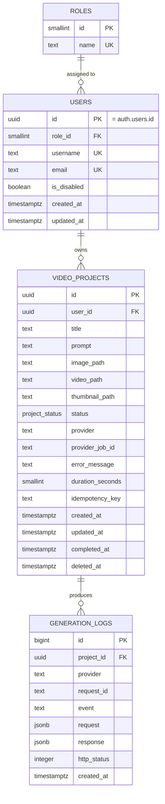

# Data Model — Cretona

**Version:** 0.1 · **Status:** Draft · **Database:** Postgres 15 (Supabase)

---

## 1. Entity Relationship



---

## 2. Tables

### 2.1 `roles`

| Column | Type | Constraints |
|---|---|---|
| `id` | `smallserial` | PK |
| `name` | `text` | UNIQUE NOT NULL |

Seeded with `user` (id 1) and `admin` (id 2). A tiny lookup table rather than an enum so roles can be added without a migration.

### 2.2 `users`

Mirrors `auth.users`, which Supabase owns. `users.id` **is** `auth.users.id` — one row per identity, never a separate key.

| Column | Type | Constraints | Notes |
|---|---|---|---|
| `id` | `uuid` | PK, FK → `auth.users(id)` ON DELETE CASCADE | |
| `role_id` | `smallint` | NOT NULL, FK → `roles(id)`, DEFAULT 1 | |
| `username` | `text` | UNIQUE, NULL allowed | 3–30 chars, `[a-zA-Z0-9_]` |
| `email` | `text` | NOT NULL UNIQUE | denormalized from `auth.users` for admin search |
| `is_disabled` | `boolean` | NOT NULL DEFAULT false | **not in the original plan**; required by FR-1.8 / FR-4.2 |
| `created_at` | `timestamptz` | NOT NULL DEFAULT `now()` | |
| `updated_at` | `timestamptz` | NOT NULL DEFAULT `now()` | maintained by trigger |

**Population.** A `SECURITY DEFINER` trigger on `auth.users AFTER INSERT` creates the matching row with `role_id = 1`. Application code never inserts into `users` directly, so an account can never exist in auth without a profile.

### 2.3 `video_projects`

| Column | Type | Constraints | Notes |
|---|---|---|---|
| `id` | `uuid` | PK DEFAULT `gen_random_uuid()` | |
| `user_id` | `uuid` | NOT NULL, FK → `users(id)` ON DELETE CASCADE | |
| `title` | `text` | NOT NULL, ≤ 120 | derived from prompt when omitted |
| `prompt` | `text` | NULL allowed, ≤ 1000 | null for image-only |
| `image_path` | `text` | NULL allowed | Storage object key, **not** a URL |
| `video_path` | `text` | NULL allowed | Storage object key of the re-hosted result |
| `thumbnail_path` | `text` | NULL allowed | |
| `status` | `project_status` | NOT NULL DEFAULT `'pending'` | enum type |
| `provider` | `text` | NOT NULL | **added** — needed to poll without joining logs |
| `provider_job_id` | `text` | NULL allowed | **added** — set once the provider accepts the job |
| `error_message` | `text` | NULL allowed | **added** — user-readable failure reason |
| `error_code` | `text` | NULL allowed, CHECK against the taxonomy | **added in migration 002** — machine-readable failure reason |
| `duration_seconds` | `smallint` | NULL allowed | |
| `idempotency_key` | `text` | NULL allowed | **added** — supports safe submit retries |
| `attempt_count` | `smallint` | NOT NULL DEFAULT 0 | retry accounting |
| `created_at` | `timestamptz` | NOT NULL DEFAULT `now()` | |
| `updated_at` | `timestamptz` | NOT NULL DEFAULT `now()` | trigger-maintained |
| `completed_at` | `timestamptz` | NULL allowed | set on `completed` or `failed` |
| `deleted_at` | `timestamptz` | NULL allowed | soft delete; media is hard-deleted immediately |

```sql
CREATE TYPE project_status AS ENUM ('pending', 'generating', 'completed', 'failed');
```

**Constraints**

```sql
-- A project must carry at least one input; this is what makes the three
-- generation modes representable in one table.
ALTER TABLE video_projects ADD CONSTRAINT chk_has_input
  CHECK (prompt IS NOT NULL OR image_path IS NOT NULL);

-- A completed project must have a video.
ALTER TABLE video_projects ADD CONSTRAINT chk_completed_has_video
  CHECK (status <> 'completed' OR video_path IS NOT NULL);

-- A failed project must say why, in both registers: prose for the user and a
-- code for the quota query.
ALTER TABLE video_projects ADD CONSTRAINT chk_failed_has_reason
  CHECK (status <> 'failed' OR error_message IS NOT NULL);
ALTER TABLE video_projects ADD CONSTRAINT chk_failed_has_code
  CHECK (status <> 'failed' OR error_code IS NOT NULL);

-- The taxonomy is AI_PROVIDER_SPEC.md §2.1. Text plus CHECK rather than an
-- enum, because providers keep inventing failure modes and widening a CHECK is
-- a one-line migration.
ALTER TABLE video_projects ADD CONSTRAINT chk_error_code
  CHECK (error_code IS NULL OR error_code IN (
    'content_policy', 'invalid_input', 'quota', 'timeout', 'provider_error', 'unknown'
  ));

-- Idempotency is scoped per user.
CREATE UNIQUE INDEX uq_projects_idempotency
  ON video_projects (user_id, idempotency_key)
  WHERE idempotency_key IS NOT NULL;
```

**Paths, not URLs.** Only Storage object keys are persisted. Signed URLs are minted per response (API_CONTRACT §3.1) because they expire — storing them would guarantee stale links.

**State machine**

```
pending ──► generating ──┬──► completed
                         └──► failed ──► pending   (retry, FR-2.11)
```
Any other transition is a bug. Enforced in the service layer, and asserted in tests.

### 2.4 `generation_logs`

Append-only audit of every provider interaction during its retention window
(FR-2.10). The only delete path is the server-owned retention worker described
in section 7; clients never write or prune this table.

| Column | Type | Constraints | Notes |
|---|---|---|---|
| `id` | `bigserial` | PK | high volume, so bigint not uuid |
| `project_id` | `uuid` | NOT NULL, FK → `video_projects(id)` ON DELETE CASCADE | |
| `provider` | `text` | NOT NULL | |
| `request_id` | `text` | NULL allowed | provider-side correlation id |
| `event` | `text` | NOT NULL | `submit` · `poll` · `webhook` · `download` · `error` |
| `request` | `jsonb` | NULL allowed | **credentials redacted before insert** |
| `response` | `jsonb` | NULL allowed | truncated to 32 KB |
| `http_status` | `integer` | NULL allowed | |
| `created_at` | `timestamptz` | NOT NULL DEFAULT `now()` | |

Logs survive project soft-deletion for auditing and cost reconciliation.

---

## 3. Indexes

```sql
CREATE INDEX idx_projects_user_created   ON video_projects (user_id, created_at DESC)
  WHERE deleted_at IS NULL;                        -- history list (FR-3.1)
CREATE INDEX idx_projects_status_created ON video_projects (status, created_at)
  WHERE status IN ('pending', 'generating');       -- poller scan (FR-2.7)
CREATE INDEX idx_projects_provider_job   ON video_projects (provider, provider_job_id);
CREATE INDEX idx_logs_project_created    ON generation_logs (project_id, created_at DESC);
CREATE INDEX idx_logs_retention          ON generation_logs (created_at ASC, id ASC);
CREATE INDEX idx_users_email             ON users (lower(email));   -- admin search
CREATE INDEX idx_projects_quota          ON video_projects (user_id, created_at DESC, error_code)
  WHERE deleted_at IS NULL;                        -- quota accounting (ADR-007)
```

The poller index is partial on purpose: it stays small no matter how many completed projects accumulate.

---

## 4. Row Level Security

RLS is enabled on `users`, `video_projects`, and `generation_logs`. The backend uses the `service_role` key, which bypasses RLS — RLS is the second line of defence for the anon key held by the app, not a replacement for authorization checks in the service layer (NFR-2.3, NFR-2.4).

```sql
ALTER TABLE users           ENABLE ROW LEVEL SECURITY;
ALTER TABLE video_projects  ENABLE ROW LEVEL SECURITY;
ALTER TABLE generation_logs ENABLE ROW LEVEL SECURITY;

CREATE OR REPLACE FUNCTION is_admin() RETURNS boolean
LANGUAGE sql STABLE SECURITY DEFINER AS $$
  SELECT EXISTS (
    SELECT 1 FROM users u JOIN roles r ON r.id = u.role_id
    WHERE u.id = auth.uid() AND r.name = 'admin'
  );
$$;

-- users
CREATE POLICY users_select_self  ON users FOR SELECT USING (id = auth.uid() OR is_admin());
CREATE POLICY users_update_self  ON users FOR UPDATE USING (id = auth.uid())
                                          WITH CHECK (id = auth.uid());

-- video_projects
CREATE POLICY projects_select_own ON video_projects FOR SELECT
  USING ((user_id = auth.uid() AND deleted_at IS NULL) OR is_admin());
CREATE POLICY projects_insert_own ON video_projects FOR INSERT
  WITH CHECK (user_id = auth.uid());
CREATE POLICY projects_update_own ON video_projects FOR UPDATE
  USING (user_id = auth.uid()) WITH CHECK (user_id = auth.uid());

-- generation_logs: readable only through owned projects; never client-writable
CREATE POLICY logs_select_own ON generation_logs FOR SELECT
  USING (EXISTS (
    SELECT 1 FROM video_projects p
    WHERE p.id = generation_logs.project_id
      AND (p.user_id = auth.uid() OR is_admin())
  ));
```

Note `users_update_self` has no `role_id` guard in the policy itself — role changes must go through the backend, so a column-level `GRANT` restricts the anon role to `username` only.

---

## 5. Storage Buckets

| Bucket | Public | Contents | Path convention |
|---|---|---|---|
| `uploads` | no | user-supplied source images | `uploads/{user_id}/{yyyy-mm-dd}/{uuid}.{ext}` |
| `videos` | no | re-hosted generated videos and thumbnails | `videos/{user_id}/{project_id}/{video\|thumb}.{ext}` |

Both are private. Reads happen through signed URLs (~1 h). Writes to `uploads` come from the app via a signed upload URL scoped to a single object key; writes to `videos` come only from the backend.

Embedding `{user_id}` as the first path segment lets Storage policies authorize on the path prefix, which is what stops one user from requesting a signed URL for another's object.

> The paths above are the full logical paths. Inside Storage, an object's `name` does **not** repeat the bucket, so `uploads/{user_id}/…` is stored as `name = '{user_id}/…'` in bucket `uploads`. Policies therefore test `(storage.foldername(name))[1] = auth.uid()::text`.

---

## 6. Prisma Mapping Notes

- Prisma models the `public` schema only; `auth.users` stays outside Prisma's control. The FK from `users.id` is declared in raw SQL migration, not in `schema.prisma`.
- `project_status` maps to a Prisma `enum ProjectStatus`.
- `generation_logs.request` / `response` map to `Json?`.
- Migrations are Prisma-managed; the trigger, RLS policies, `is_admin()`, and partial indexes live in `prisma/migrations/*/migration.sql` as raw SQL so they are versioned with everything else.
- The backend connects with the pooled Supabase connection string; `DIRECT_URL` is set for migrations.

---

## 7. Retention

| Data | Policy |
|---|---|
| Soft-deleted projects | purged after 30 days |
| `generation_logs` | raw rows retained 180 days; a bounded oldest-first worker emits counts grouped by provider, event, and HTTP status to structured logs, then atomically deletes the batch |
| Source images | deleted with the project |
| Generated videos | deleted with the project |
| Account deletion | cascades to projects and media; logs anonymized (`user_id` nulled on the project) |

The worker runs once on FastAPI startup and then daily by default. Postgres
uses `FOR UPDATE SKIP LOCKED`, so concurrent instances delete disjoint batches;
SQLite uses one atomic `DELETE ... RETURNING` statement. Neither path selects
the raw `request` or `response` payload for aggregation. The aggregate is only
as durable as the structured-log destination: persistent shipping and sampling
remain B-7, and must be configured before claiming long-term aggregate history.

`supabase/006_add_generation_log_retention_index.sql` is prepared but not
applied. It builds the table-wide cutoff index concurrently; the existing
project-scoped index cannot efficiently serve this maintenance query.
