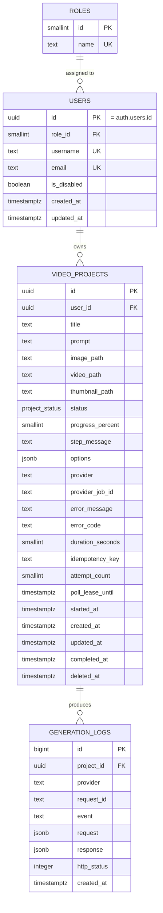

# Data Model — Cretona

**Version:** 1.0 · **Status:** Accepted Baseline · **Database:** PostgreSQL 16 (Supabase)

---

## 1. Entity Relationship Diagram



---

## 2. Tables & Schema

### 2.1 `roles`
Lookup table for system roles.
- `id` (`smallserial` PK)
- `name` (`text` UNIQUE NOT NULL) — Seeded with `'user'` (1) and `'admin'` (2).

### 2.2 `users`
Mirrors Supabase `auth.users`. `users.id` directly references `auth.users.id`.
- `id` (`uuid` PK, FK $\rightarrow$ `auth.users(id)` ON DELETE CASCADE)
- `role_id` (`smallint` NOT NULL, FK $\rightarrow$ `roles(id)`, DEFAULT 1)
- `username` (`text` UNIQUE, NULL allowed, 3–30 chars)
- `email` (`text` NOT NULL UNIQUE)
- `is_disabled` (`boolean` NOT NULL DEFAULT false)
- `created_at` (`timestamptz` NOT NULL DEFAULT `now()`)
- `updated_at` (`timestamptz` NOT NULL DEFAULT `now()`)

### 2.3 `video_projects`
Central record for all text-to-video and image-to-video generation tasks.

| Column | Type | Constraints & Defaults | Description |
|---|---|---|---|
| `id` | `uuid` | PK DEFAULT `gen_random_uuid()` | Unique project identifier |
| `user_id` | `uuid` | NOT NULL, FK $\rightarrow$ `users(id)` | Owner identifier |
| `title` | `text` | NOT NULL, $\le 120$ chars | Project title (or generated from prompt) |
| `prompt` | `text` | NULL allowed, $\le 1000$ chars | Creative generation prompt |
| `image_path` | `text` | NULL allowed | Storage key for reference input image |
| `video_path` | `text` | NULL allowed | Storage key for generated MP4 video |
| `thumbnail_path` | `text` | NULL allowed | Storage key for video preview image |
| `status` | `project_status` | NOT NULL DEFAULT `'pending'` | Enum: `pending`, `generating`, `completed`, `failed`, `cancelled` |
| `progress_percent` | `smallint` | NOT NULL DEFAULT 0 | Real-time progress percentage (0–100) |
| `step_message` | `text` | NULL allowed | Current pipeline stage description |
| `options` | `jsonb` | NULL allowed | Style preset, camera motion, aspect ratio |
| `provider` | `text` | NOT NULL | Canonical provider key: `fake`, `real`, `local`, `kaggle` |
| `provider_job_id` | `text` | NULL allowed | External provider job reference |
| `error_message` | `text` | NULL allowed | User-facing failure description |
| `error_code` | `text` | NULL allowed | Machine-readable error code |
| `duration_seconds` | `smallint` | NULL allowed | Output video length in seconds |
| `idempotency_key` | `text` | NULL allowed | Client UUID for duplicate prevention |
| `attempt_count` | `smallint` | NOT NULL DEFAULT 0 | Generation attempt counter |
| `poll_lease_until` | `timestamptz` | NULL allowed | Lease expiration timestamp for poller |
| `started_at` | `timestamptz` | NULL allowed | Generation start timestamp |
| `created_at` | `timestamptz` | NOT NULL DEFAULT `now()` | Creation timestamp |
| `updated_at` | `timestamptz` | NOT NULL DEFAULT `now()` | Modification timestamp |
| `completed_at` | `timestamptz` | NULL allowed | Finalization timestamp |
| `deleted_at` | `timestamptz` | NULL allowed | Soft-deletion timestamp |

### 2.4 `generation_logs`
Append-only audit trail of provider interactions with automated 180-day retention pruning.

---

## 3. Database Constraints & Indexes

```sql
-- Enforce at least one input mode
ALTER TABLE video_projects ADD CONSTRAINT chk_has_input
  CHECK (prompt IS NOT NULL OR image_path IS NOT NULL);

-- Completed projects must hold a video path
ALTER TABLE video_projects ADD CONSTRAINT chk_completed_has_video
  CHECK (status <> 'completed' OR video_path IS NOT NULL);

-- Failed projects must specify reason and error code
ALTER TABLE video_projects ADD CONSTRAINT chk_failed_has_reason
  CHECK (status <> 'failed' OR error_message IS NOT NULL);
ALTER TABLE video_projects ADD CONSTRAINT chk_failed_has_code
  CHECK (status <> 'failed' OR error_code IS NOT NULL);

-- Partial indexes for ultra-fast queries
CREATE INDEX idx_projects_user_created   ON video_projects (user_id, created_at DESC) WHERE deleted_at IS NULL;
CREATE INDEX idx_projects_status_created ON video_projects (status, created_at) WHERE status IN ('pending', 'generating');
CREATE INDEX idx_projects_provider_job   ON video_projects (provider, provider_job_id);
CREATE INDEX idx_logs_project_created    ON generation_logs (project_id, created_at DESC);
CREATE INDEX idx_logs_retention          ON generation_logs (created_at ASC, id ASC);
CREATE INDEX idx_users_email             ON users (lower(email));
```

---

## 4. Credits, events, packages and payments

Added by `supabase/013_add_credits_and_events.sql`, applied to live Supabase on
2026-08-28. Closes the six tables §5 of the exam brief names as the minimum
schema. Wire contract: `API_CONTRACT.md` Part II.

### 4.1 The tables

| Table | Purpose |
|---|---|
| `credit_transactions` | The append-only ledger. Signed `delta`; every row carries `balance_after` |
| `credit_packages` | What a user can buy. Deactivated, never deleted |
| `payments` | Purchases. `method` is always `simulated` today — see `ADR-010` |
| `events` | Promotions. One table for both grants and discounts |
| `event_claims` | Who took up which campaign, in which period |
| `settings` | Admin-configurable values. Currently `generation_cost_credits` |

Plus `users.credit_balance` (integer, default 0, `>= 0` enforced by CHECK).

### 4.2 The ledger is the truth

`users.credit_balance` is a **cache**. Every change to it is written in the same
transaction as a `credit_transactions` row, and `balance_after` on each row is
what makes disagreement between the two detectable:

```sql
select u.id from public.users u
where u.credit_balance <> coalesce(
  (select sum(t.delta) from public.credit_transactions t where t.user_id = u.id), 0);
```

That query returning any row is a bug, not a reconciliation task. It is exposed
as `GET /admin/credits/drift`, because `ProjectService._refund_generation`
deliberately swallows its own errors — a refund that raised would turn a failed
generation into a 500 and strand the project — and a silently failed refund has
no other symptom.

Never update or delete a ledger row. `CreditService` is the only writer of a
balance.

### 4.3 One table for two kinds of campaign

`events.kind` is `grant` or `discount`. A grant gives credits when claimed; a
discount lowers the generation price by itself and is never claimable. They
share a row shape because they differ only in payload — splitting them would
have duplicated the window, recurrence and cap logic, which is most of the
complexity.

| Behaviour | kind | recurrence | fields |
|---|---|---|---|
| Hot hours, −50% 20:00–22:00 | `discount` | `daily` | `discount_percent`, `active_from_minute` 1200, `active_to_minute` 1320 |
| Weekend gift, +10 | `grant` | `weekly` | `bonus_credits`, `active_days` `'sat,sun'` |
| Holiday gift | `grant` | `once` | `bonus_credits`, window = the holiday |
| Signup bonus | `grant` | `once` | `auto_grant = true` — applied on first profile read, no button |

**Minutes are local Vietnam time (UTC+7)** stored as minutes from midnight.
Storing minutes rather than timestamps is what lets one row mean "every day
between 20:00 and 22:00" without generating a row per day. A window may wrap
midnight (`1320` to `120`), which `EventService` treats as two ranges.

A CHECK enforces that a `grant` carries `bonus_credits` and no
`discount_percent`, and a `discount` the reverse — the service repeats that
validation only so an admin filling in a form learns which field is wrong.

### 4.4 What the database enforces, not the service

These are constraints rather than Python checks because a service-level check
loses to a concurrent request, and what it loses is money:

| Rule | Enforcement |
|---|---|
| A balance never goes negative | `users_credit_balance_non_negative`, plus `WHERE credit_balance + ? >= 0` on the UPDATE |
| A generation is charged once | `uq_credit_tx_idempotency` — unique `(user_id, idempotency_key)` |
| A purchase grants once | `uq_payments_idempotency` |
| One claim per campaign occurrence | `uq_event_claims_per_period` — unique `(event_id, user_id, period_key)` |
| A campaign cap holds | The `WHERE (select count(*) …) < max_claims` inside the INSERT |
| A ledger row always moves something | `CHECK (delta <> 0)` |

`period_key` is `''` for a `once` event, the local date for `daily`, and the ISO
week for `weekly`. That is what makes "once per weekend" mean a weekend rather
than forever.

### 4.5 Row-level security

Same posture as `users` and `video_projects`: a user reads only their own rows,
writes nothing directly, and every mutation goes through FastAPI.

- `credit_transactions`, `event_claims`, `payments` — select own only
- `credit_packages`, `events` — any signed-in user may read active rows
- `settings` — RLS on with **no policy**, which denies every anon and
  authenticated read. Only the service role needs it.

### 4.6 The SQLite mirror

`app/database.py` reproduces every constraint above. `Database.initialize()`
also seeds the generation cost, the signup-bonus event and the three credit
packages, mirroring `supabase/seed_credits_and_events.sql` — without them a
local database has the tables but no rows, and a new account can never generate
anything. `test_sqlite_defaults_match_the_seed` parses the SQL file and fails if
the two drift apart.

---

## 5. External Kaggle worker boundary

Migration `014_add_kaggle_worker.sql` adds no business table. It adds a
least-privilege execution boundary around existing `video_projects`,
`generation_logs`, `users`, and `credit_transactions` rows:

| Object | Contract |
|---|---|
| `cretona_kaggle_worker` | Login role with no table grants, no role/database creation, no superuser and no RLS bypass |
| `private.cretona_kaggle_claim_job` | Atomically claims one text-only `provider='kaggle'` row with `SKIP LOCKED` and a bounded lease |
| `private.cretona_kaggle_heartbeat` | Renews only the caller-owned lease and persists bounded progress |
| `private.cretona_kaggle_complete` | Completes only the leased row with canonical `{user_id}/{project_id}/video.mp4` and logs its SHA-256 |
| `private.cretona_kaggle_fail` | Fails only the leased row and atomically refunds the newest unrefunded generation charge |
| Storage policies | Permit the dedicated Auth worker to insert/select/update only the canonical object of its active lease |

The database login and Auth user are deliberately separate. The worker never
receives `service_role`. Storage authorization reads only
`raw_app_meta_data`/`app_metadata.cretona_worker`, not user-editable metadata.
