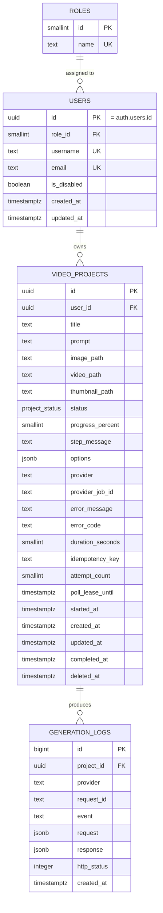

# Data Model — Cretona

**Version:** 1.0 · **Status:** Accepted Baseline · **Database:** PostgreSQL 16 (Supabase)

---

## 1. Entity Relationship Diagram



---

## 2. Tables & Schema

### 2.1 `roles`
Lookup table for system roles.
- `id` (`smallserial` PK)
- `name` (`text` UNIQUE NOT NULL) — Seeded with `'user'` (1) and `'admin'` (2).

### 2.2 `users`
Mirrors Supabase `auth.users`. `users.id` directly references `auth.users.id`.
- `id` (`uuid` PK, FK $\rightarrow$ `auth.users(id)` ON DELETE CASCADE)
- `role_id` (`smallint` NOT NULL, FK $\rightarrow$ `roles(id)`, DEFAULT 1)
- `username` (`text` UNIQUE, NULL allowed, 3–30 chars)
- `email` (`text` NOT NULL UNIQUE)
- `is_disabled` (`boolean` NOT NULL DEFAULT false)
- `created_at` (`timestamptz` NOT NULL DEFAULT `now()`)
- `updated_at` (`timestamptz` NOT NULL DEFAULT `now()`)

### 2.3 `video_projects`
Central record for all text-to-video and image-to-video generation tasks.

| Column | Type | Constraints & Defaults | Description |
|---|---|---|---|
| `id` | `uuid` | PK DEFAULT `gen_random_uuid()` | Unique project identifier |
| `user_id` | `uuid` | NOT NULL, FK $\rightarrow$ `users(id)` | Owner identifier |
| `title` | `text` | NOT NULL, $\le 120$ chars | Project title (or generated from prompt) |
| `prompt` | `text` | NULL allowed, $\le 1000$ chars | Creative generation prompt |
| `image_path` | `text` | NULL allowed | Storage key for reference input image |
| `video_path` | `text` | NULL allowed | Storage key for generated MP4 video |
| `thumbnail_path` | `text` | NULL allowed | Storage key for video preview image |
| `status` | `project_status` | NOT NULL DEFAULT `'pending'` | Enum: `pending`, `generating`, `completed`, `failed`, `cancelled` |
| `progress_percent` | `smallint` | NOT NULL DEFAULT 0 | Real-time progress percentage (0–100) |
| `step_message` | `text` | NULL allowed | Current pipeline stage description |
| `options` | `jsonb` | NULL allowed | Style preset, camera motion, aspect ratio |
| `provider` | `text` | NOT NULL | Provider key: `fake`, `real`, `wan21` |
| `provider_job_id` | `text` | NULL allowed | External provider job reference |
| `error_message` | `text` | NULL allowed | User-facing failure description |
| `error_code` | `text` | NULL allowed | Machine-readable error code |
| `duration_seconds` | `smallint` | NULL allowed | Output video length in seconds |
| `idempotency_key` | `text` | NULL allowed | Client UUID for duplicate prevention |
| `attempt_count` | `smallint` | NOT NULL DEFAULT 0 | Generation attempt counter |
| `poll_lease_until` | `timestamptz` | NULL allowed | Lease expiration timestamp for poller |
| `started_at` | `timestamptz` | NULL allowed | Generation start timestamp |
| `created_at` | `timestamptz` | NOT NULL DEFAULT `now()` | Creation timestamp |
| `updated_at` | `timestamptz` | NOT NULL DEFAULT `now()` | Modification timestamp |
| `completed_at` | `timestamptz` | NULL allowed | Finalization timestamp |
| `deleted_at` | `timestamptz` | NULL allowed | Soft-deletion timestamp |

### 2.4 `generation_logs`
Append-only audit trail of provider interactions with automated 180-day retention pruning.

---

## 3. Database Constraints & Indexes

```sql
-- Enforce at least one input mode
ALTER TABLE video_projects ADD CONSTRAINT chk_has_input
  CHECK (prompt IS NOT NULL OR image_path IS NOT NULL);

-- Completed projects must hold a video path
ALTER TABLE video_projects ADD CONSTRAINT chk_completed_has_video
  CHECK (status <> 'completed' OR video_path IS NOT NULL);

-- Failed projects must specify reason and error code
ALTER TABLE video_projects ADD CONSTRAINT chk_failed_has_reason
  CHECK (status <> 'failed' OR error_message IS NOT NULL);
ALTER TABLE video_projects ADD CONSTRAINT chk_failed_has_code
  CHECK (status <> 'failed' OR error_code IS NOT NULL);

-- Partial indexes for ultra-fast queries
CREATE INDEX idx_projects_user_created   ON video_projects (user_id, created_at DESC) WHERE deleted_at IS NULL;
CREATE INDEX idx_projects_status_created ON video_projects (status, created_at) WHERE status IN ('pending', 'generating');
CREATE INDEX idx_projects_provider_job   ON video_projects (provider, provider_job_id);
CREATE INDEX idx_logs_project_created    ON generation_logs (project_id, created_at DESC);
CREATE INDEX idx_logs_retention          ON generation_logs (created_at ASC, id ASC);
CREATE INDEX idx_users_email             ON users (lower(email));
```
