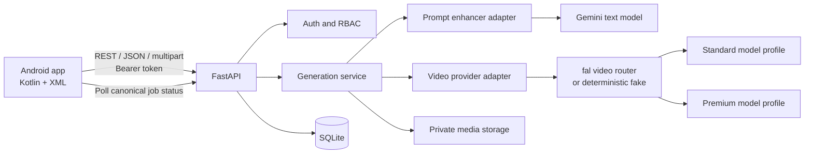

# Cretona — Recommended project proposal

- **Proposal ID:** `CRETONA-PROP-001`
- **Status:** Baseline accepted for scaffold on 2026-08-10
- **Original date:** 2026-08-06
- **Team:** Bruce + S0ra1n0 (two developers total)

## 1. Executive decision

Build Cretona as an Android application that turns a text prompt and zero or
one reference image into a short AI-generated video. The Android app calls a
FastAPI backend; only FastAPI may call model providers or hold their keys.

The final MVP is `CAND-002`, but delivery is deliberately text-first:

1. Complete authentication and the text-to-video path end to end.
2. Add one optional reference image through the same API and job model.
3. Add the minimum admin flow and finalize acceptance evidence.

This gives the project meaningful Mobile 1 scope without attempting to clone
CapCut, Canva, Kling, or Runway. Arbitrary raw-model selection, a video-editing
timeline, payments, and social features are explicitly excluded.

## 2. Product value and demo story

The strongest academic value is not “another AI generator.” It is a complete,
explainable distributed-mobile workflow:

> A user logs in, asks a text LLM to improve a creative prompt, approves the
> result, optionally attaches an image, starts a paid video-generation job,
> watches its canonical status, and plays the saved result. An admin can inspect
> users and jobs without gaining access to passwords or provider secrets.

The final demonstration should show success, validation failure, authorization
failure, and provider failure. A polished happy path alone is not sufficient.

## 3. Approved-scope proposal

### `P0` — Required for a complete project

- Register, login, logout, and persistent Android session.
- `user` and `admin` roles enforced by FastAPI.
- Text prompt entry and server-side LLM prompt enhancement.
- Original/enhanced prompt comparison and explicit user confirmation.
- Text-to-video generation through one video-router provider with stable
  `Standard` and `Premium` quality profiles.
- Zero-or-one reference-image upload for image-guided generation.
- Persisted job states: `submitted`, `queued`, `processing`, `succeeded`,
  `failed`.
- Per-user history, job detail, result playback, and safe error messages.
- Admin user list, enable/disable user, and all-job metadata list.
- Fake provider for deterministic development and demo fallback.
- A blind paid benchmark followed by bounded live end-to-end evidence.
- Pre-generation cost estimate and explicit confirmation for `Premium`.

### `P1` — Add only after every `P0` acceptance scenario passes

- Download/share the completed video.
- Prompt templates such as cinematic, product, anime, or nature.
- Manual retry that creates a clearly separate, billable attempt.
- Basic profile update.

### Explicit non-scope

- Direct integrations with multiple provider-specific contracts or exposing
  arbitrary endpoint/model IDs to Android.
- Video-to-video editing, timeline editing, transitions, captions, or audio
  mixing.
- Payments, subscriptions, social feed, likes, comments, or followers.
- Training or fine-tuning a video model.
- Redis, RabbitMQ, Celery, Kubernetes, microservices, or GraphQL.
- Production SaaS availability or enterprise security claims.

## 4. System boundary

Trust rules:

- Android knows Cretona API contracts, never provider payloads or secrets.
- FastAPI owns identity, roles, ownership checks, prompt approval, quality-
  profile mapping, quota, job states, and cost controls.
- The provider adapter is the only module that knows external model request and
  response shapes.
- SQLite and media storage are private to FastAPI; Android accesses results
  only through authorized endpoints.

## 5. Technology proposal

### Android owner: Bruce

| Choice | Decision and rationale |
|---|---|
| Language/UI | Kotlin + XML Views + Material Components. This aligns with a first Mobile course and avoids maintaining both XML and Compose conventions. |
| Presentation | MVVM with one ViewModel per screen/flow and immutable `StateFlow` UI state. |
| Networking | Retrofit + OkHttp; one DTO layer mapped into app models. |
| Async | Kotlin Coroutines; lifecycle-aware collection. |
| Session/settings | DataStore; never log bearer tokens. |
| Images | Android Photo Picker + Coil preview; no broad storage permission. |
| Video | AndroidX Media3 ExoPlayer. |
| Navigation | Navigation Component with XML fragments. |
| Tests | ViewModel/unit tests plus focused instrumentation tests for the critical path. |

### Backend owner: S0ra1n0

| Choice | Decision and rationale |
|---|---|
| Runtime | Python 3.12 + FastAPI + Uvicorn. |
| Configuration | Pydantic Settings and `.env.example`; real secrets remain outside Git. |
| Database | SQLAlchemy 2 + SQLite for the local academic MVP. The repository pattern must permit later PostgreSQL migration without adding it now. |
| Auth | Bearer JWT access token, password hashing, server-enforced role and object ownership. |
| Model SDK | Google GenAI SDK for text enhancement and fal client/REST for video, both behind local adapter interfaces. |
| HTTP/files | FastAPI upload/response support with allowlisted image types, explicit size limit, and private media directory. |
| Tests | pytest + FastAPI/httpx test client; live-provider tests are opt-in. |

### Model and quality-profile choice

- Prompt enhancement: `gemini-2.5-flash` as the initial stable, low-cost text
  model. Its ID remains environment configuration.
- Video access: one fal video-router adapter so the team can benchmark Kling,
  Veo, Sora, and Seedance without implementing separate credentials, queues,
  billing, and response contracts for each vendor.
- `STANDARD` initial candidate: Kling 3 Pro, 720p, 5s; approximately USD 0.56
  without audio or USD 0.84 with audio at the observed fal price.
- `PREMIUM` initial candidate: Veo 3.1 Standard, 1080p, 5s with audio;
  approximately USD 2.00 at the observed fal price.
- Challengers: Veo 3.1 Fast and Sora 2 Pro. The final mappings are selected by
  the blind benchmark, not by these initial labels.
- Fallback: `FakeVideoProvider`, which simulates all canonical states and returns
  a known local MP4. The fake is mandatory for ordinary tests and demo recovery.

The bounded market evidence, price table, blind scoring rubric, and stop rules
are authoritative in `docs/discovery/VIDEO-PROVIDER-LANDSCAPE.md`. Prices and
model availability must be rechecked immediately before live use.

## 6. Job and data design

### Minimal entities

`User`

- `id`, `email`, `password_hash`, `role`, `is_enabled`, `created_at`,
  `updated_at`.

`GenerationJob`

- `id`, `owner_id`, `original_prompt`, `enhanced_prompt`, `approved_prompt`,
  optional input-image metadata, quality profile, aspect ratio, requested
  duration, router/provider, configured endpoint/model, estimated and actual
  cost metadata, canonical state, external job/interaction ID, safe error
  code/message, output metadata, timestamps.

### Invariants

1. A generation job belongs to exactly one user.
2. Only its owner or an admin may read job metadata or result content.
3. A paid video call requires an authenticated enabled user, an approved prompt,
   valid optional image, server-enabled quality profile, accepted cost estimate,
   and available quota/budget.
4. A job has one initial billable provider submission. Retrying creates a new
   attempt/job; no silent automatic retry is permitted.
5. Terminal state does not move back to a non-terminal state.
6. Provider keys, passwords, and bearer tokens never enter job records.

## 7. API proposal

Use REST under `/api/v1`. FastAPI-generated OpenAPI is authoritative after
contract approval.

- `POST /auth/register`, `POST /auth/login`, `GET /users/me`.
- `POST /prompts/enhance` — text LLM only; creates no video charge.
- `GET /generation-capabilities` — returns stable quality profiles, allowed
  duration/aspect ratio, audio availability, and current maximum cost estimate;
  it never exposes provider secrets.
- `POST /generations` — one `multipart/form-data` contract with text/options and
  an optional image plus selected quality profile and accepted estimate version;
  returns `202` and a Cretona job ID.
- `GET /generations`, `GET /generations/{id}`,
  `GET /generations/{id}/content`.
- `GET /admin/users`, `PATCH /admin/users/{id}/status`,
  `GET /admin/generations`.
- `GET /health` with no secret or sensitive dependency details.

Android polls a Cretona job, not the provider. After persisting `submitted`,
FastAPI uses one in-process background worker to perform the provider call and
update canonical state. This is acceptable for the local, low-concurrency MVP
and avoids an unowned Redis/Celery system. On backend restart, non-terminal jobs
may be reconciled only when the provider exposes a safe external job ID;
otherwise they become `failed/BACKEND_RESTARTED`. They are never resubmitted
automatically because that could create a duplicate charge.

## 8. Cost and failure controls

- Project live-provider envelope: maximum USD 25, authorized separately from
  approving source code or the architecture.
- Budget buckets: USD 15 benchmark, USD 5 integration verification, USD 5 final
  demo reserve. Reaching one bucket stops that activity.
- Default `Standard`: 5 seconds, 720p, one video per request.
- Default `Premium`: maximum 5 seconds and USD 2.50 per request.
- Development and CI: fake provider only.
- Per-user live quota during testing: three accepted submissions, further
  constrained by the current budget bucket.
- Final demo: one prepared `Standard`, one prepared `Premium`, plus a fake or
  recorded fallback.
- No automatic billable retry or batch generation.
- Endpoint/model IDs, profile mapping, live mode, duration, quotas, pricing
  snapshot, and budget mode are server configuration, not Android constants.
- Android shows a server-calculated maximum estimate and requires explicit
  confirmation before `Premium`; the backend revalidates the estimate/version.
- Moderation, quota, timeout, rate limit, invalid image, provider outage, and
  expired output are explicit user-visible failure paths.

The initial twelve-run blind benchmark is estimated at roughly USD 14–15 using
current public prices. The USD 25 envelope is a hard upper boundary, not an
invitation to spend it. Price is rechecked before each benchmark group, and no
document authorizes automatic purchasing or account top-up.

## 9. Runtime and deployment proposal

Development and final demonstration use one team laptop:

- FastAPI listens on the local network only for the demo.
- Android emulator uses the host mapping where applicable; a physical device
  uses the laptop LAN address.
- SQLite, uploaded images, and generated MP4 files live in ignored backend
  runtime directories.
- A seed command creates the first admin; no default admin password is committed.
- Public cloud deployment and PostgreSQL are stretch work only after all local
  acceptance scenarios pass.

This deliberately avoids owning a public server, database backups, TLS, domain,
secret manager, and persistent media storage before the course requires them.

## 10. Five delivery waves

### Wave 1 — Contract and walking skeleton

- Extend the root Android project under `app/` and scaffold the active service
  under `backend-fastapi/`; retain `backend/` as migration reference evidence.
- Freeze OpenAPI DTOs, error codes, canonical states, and `.env.example`.
- Prove Android → `/health` → correlated FastAPI log.
- Run the bounded blind provider benchmark before freezing `Standard` and
  `Premium` endpoint mappings.

### Wave 2 — Identity and authorization

- Register/login/logout/me.
- DataStore session and protected Android navigation.
- User/admin and object-ownership tests.

### Wave 3 — Text-first vertical slice

- Fake provider and persistent job state.
- Prompt enhancement with confirmation.
- Text generation form, polling, history, failure states, and playback.
- Integrate the benchmark-selected `Standard` profile through FastAPI.

### Wave 4 — Image and admin completion

- Photo Picker, preview, multipart upload, validation, retention cleanup.
- Integrate and verify the selected `Premium` profile with explicit cost
  confirmation.
- Minimal admin users/jobs screens.
- Full `CAND-002` end-to-end scenario.

### Wave 5 — Verification and presentation

- Backend tests, Android tests/build, all SRS acceptance scenarios.
- Secret/cost audit, device/emulator evidence, and final demo script.
- Live provider path plus deterministic fallback.

If the actual course deadline is shorter, preserve waves and reduce optional
scope; do not parallelize implementation before the API contract is frozen.

## 11. Team ownership

- Bruce owns `app/`, UX acceptance, Android tests, and final demo flow.
- S0ra1n0 owns `backend/`, database/auth, provider adapters, and backend tests.
- S0ra1n0 is primary writer of OpenAPI behavior; Bruce reviews it as the Android
  consumer before implementation.
- Both own the first integration of each vertical slice and must record executed
  evidence.

The detailed task IDs and dependencies are in
`docs/TEAM-WORK-SPLIT-DRAFT.md`.

## 12. Approval and next gate

This proposal is decision-ready, not implementation authorization. Bruce and
S0ra1n0 should review `docs/DECISIONS.md` and change the seven rows from
`Proposed` to `Accepted` if they agree.

After approval, the project reaches:

- `L1 SCOPED`: passed.
- `L2 SPECIFIED`: passed for the MVP behaviors in the SRS.
- `L3 DESIGNED`: provisionally passed for local development.
- `L4 BUILD-READY`: blocked until repository paths are scaffolded, commands are
  proven, the API contract is frozen, and a provider account is verified without
  committing or exposing its key.
