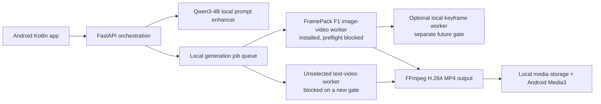

# Cretona zero-additional-spend video strategy

- **Document ID:** `CRETONA-FREE-LOCAL-001`
- **Mode:** Landscape/select
- **Observation date:** 2026-08-11
- **Decision owner:** Bruce and S0ra1n0
- **Status:** EXP-005 active; Qwen passed, LTX pre-screen rejected, FramePack installed but inference blocked

## 1. Decision and definition of free

This brief identifies the highest-quality repeatable video strategy with no
API, subscription, trial-credit, or cloud-GPU payment. It assumes the team's
existing laptop is the inference host. Electricity, hardware wear, storage,
download bandwidth, and developer time still have a real cost; therefore the
accurate term is **zero additional cash spend**, not zero cost-to-serve.

The target is not the highest-scoring open-weight model on any hardware. It is
the best output that Cretona can repeatedly generate on the measured machine
without making the final demonstration dependent on an unowned cloud quota.

## 2. Measured host constraint

| Resource | Read-only observation | Consequence |
|---|---|---|
| GPU | NVIDIA RTX 3070 Ti Laptop, 8 GB VRAM, compute capability 8.6 | Ampere CUDA is supported, but 12-24 GB reference paths do not fit directly |
| System RAM | 15,629 MB total; about 1,959 MB available at observation time | Heavy CPU offload is the dominant risk; other applications must be closed before a spike |
| Storage | About 483.5 GB free on drive D | Enough for model weights, caches, intermediate frames and outputs |
| Operating system | Windows | Prefer maintained Windows packages and reversible local workers |

The GPU observation came from `nvidia-smi`; RAM and disk came from read-only
Windows system commands. Available RAM is transient and must be remeasured
immediately before testing.

## 3. Current model landscape bounded by this hardware

Quality ranks below are not interchangeable with local feasibility. Arena
scores describe human preference across outputs, not whether a model can run
on this laptop.

| Candidate | Published capability/quality evidence | Main hardware path | Fit on this laptop | Decision |
|---|---|---|---|---|
| MiniMax H3 | Ranked first among open-source text-to-video entries in the current Arena view; native video/audio claims | Fresh community reports start around 12 GB VRAM for a pruned path | Below known minimum and too new for a course-critical dependency | Exclude now |
| Kandinsky 5 Video Lite | Ranked second in the current open-source Arena view; 2B T2V/I2V family | Official repository says generation can run at 12 GB after optimization | 8 GB is below the documented path | Exclude now |
| HunyuanVideo 1.5 | Ranked third in the current open-source Arena view; official 8.3B T2V/I2V with 720p and a 1080p super-resolution stage | Official minimum is 14 GB VRAM with offload; the official repo links a community Wan2GP route reported as low as 6 GB | Best quality ceiling among plausible low-VRAM hacks, but 16 GB system RAM makes offload/paging high-risk | Challenger only; do not make it the MVP dependency |
| LTX-2 19B | Ranked fourth in the current open-source Arena view; synchronized audio/video and strong controls | Current LTX Desktop guidance treats Windows systems below 16 GB VRAM as API-only | Does not fit the zero-paid local boundary | Exclude now |
| Wan2.2 A14B/5B | Strong current open-weight benchmark history; T2V/I2V/TI2V variants | Practical 5B path is normally associated with about 24 GB VRAM; larger variants need more | Does not fit 8 GB without an unverified extreme-offload workflow | Exclude now |
| FramePack F1 | 13B Hunyuan-based I2V with anti-drifting; official implementation explicitly supports 6 GB VRAM, Windows and RTX 30-series laptops | Official author reports a 3070 Ti laptop at roughly 4-8 times the per-frame time of a 4090 | Exact official runtime and 42.9 GB pinned model cache are installed; current RAM/VRAM/virtual-memory preflight blocks inference | First executable **reference-image** candidate; not selected |
| LTX-Video 2B v0.9.8 distilled | T2V and I2V; official model/config plus version-specific open-weight license | Raw dependencies total about 25.9 GB and the runner moves the T5 encoder and video components to the device before useful offload; current Diffusers memory example is about 10 GB VRAM; Q8/FP8 acceleration is Ada-oriented | RTX 3070 Ti is Ampere with 8 GB VRAM and 16 GB RAM; no pinned official path fits the measured envelope | Reject for this host before weight download; reopen only with new measured Ampere evidence |
| CogVideoX 2B | Apache-2.0 2B path and mature Diffusers support | Designed for older/smaller GPUs | Feasible but older and lower in independent open-video comparisons than stronger families | Fallback challenger |
| Wan2.1 T2V 1.3B | Apache-2.0 T2V model, 480p-class output, published 8.19 GB VRAM requirement | CPU offload is needed because the laptop exposes 8,192 MiB | Feasible only with tuning; text-only and not the best product fit | Baseline challenger, not the recommendation |

## 4. Recommended free architecture

The original two-profile recommendation did not survive the exact runtime
pre-screen. Keep the provider-neutral architecture, but do not assign product
profile names until a model has executed and passed.

### Text-capable local profile

- Status: **unselected**.
- LTX 2B v0.9.8 is rejected for this host by the documented memory envelope;
  its weights were intentionally not downloaded.
- FramePack F1 is image-conditioned and therefore cannot silently inherit the
  `LOCAL_STANDARD` name or prove FR-2.1 text-only generation.
- A replacement text-only model or a separately gated local-keyframe generator
  is required after the FramePack feasibility result.

### Image-conditioned local candidate

- Candidate: FramePack F1 I2V.
- Input: one reference/keyframe image plus motion/camera prompt.
- Target: one short hero clip; duration capped during the spike.
- Purpose: test the highest plausible reference consistency on this GPU when
  generation time and host stability are acceptable.
- Reason: it uses a 13B video model while the official implementation supports
  6 GB VRAM and explicitly discusses RTX 3070 Ti laptop performance.

### Text-only request in quality mode

FramePack F1 is image-conditioned. For a text-only request, the honest bounded
policies are now:

1. Keep the fake provider for integration evidence and do not claim real
   text-to-video until a second candidate passes.
2. Experimentally create a keyframe with a separately gated local image model,
   unload it, and then animate it through FramePack.

The second policy may improve composition but adds another model and is not
accepted until it passes its own RAM, latency, license, and quality gate. No
keyframe model is selected in this document.

## 5. Fully local system boundary

Recommended components:

| Boundary | Technology | Why |
|---|---|---|
| Prompt LLM | Qwen3-4B quantized, served locally through Ollama or an OpenAI-compatible local server | Apache-2.0, 4B parameters, 100+ languages; FastAPI demonstrably calls an LLM without a paid or data-sharing API |
| Video worker | Separate Python process using the selected local pipeline | Allows FastAPI to remain responsive and the GPU worker to fail/restart independently |
| Job contract | Existing canonical `QUEUED/RUNNING/SUCCEEDED/FAILED/CANCELLED` model | Keeps Android independent from LTX/FramePack implementation details |
| Media | Local bounded directory plus SQLite metadata | No cloud storage bill; simple ownership and cleanup |
| Encoding | FFmpeg to H.264 MP4 | Broad Android Media3 compatibility |
| Test/demo fallback | Existing `FakeVideoProvider` | Deterministic tests and honest recovery when local inference is too slow |

Only one large model may be loaded at a time. The worker must explicitly unload
the prompt/image model and release CUDA memory before loading the video model.

## 6. Business scope achieved

| Capability | Free local result |
|---|---|
| FastAPI calls a real LLM | Yes, local Qwen3-4B |
| Prompt improvement and user approval | Yes |
| Text-to-video | Not yet proven; LTX was rejected in pre-screen and a replacement candidate is required |
| Reference-image-to-video | Candidate only; FramePack is installed but inference is blocked by the current resource preflight |
| Standard/Quality profiles | Contract design exists, but no real video profile is selected |
| Authentication, roles, ownership, quota and history | Unchanged from the SRS |
| Cost estimate | Replaced by estimated queue time, output size and local resource warning |
| Native generated audio | No in the recommended first free slice |
| Offline after initial downloads | Yes |
| Deterministic demo fallback | Yes |

## 7. Expected quality and honest limits

No real video-quality claim is currently accepted. The fake provider proves
the workflow only, and Qwen proves prompt enhancement only.

FramePack has the strongest plausible reference-image ceiling among the
installed candidates because it uses a much larger image-conditioned video
model, but this is a hypothesis awaiting a successful run and blind score. The
official author reports a 3070 Ti laptop can be four to eight times slower per
frame than a 4090; this is feasibility context, not a measured Cretona result.

Neither route currently provides synchronized native dialogue/audio. Adding a
separate local TTS or soundtrack is possible, but lip-sync and generated-audio
quality are out of the first free MVP.

## 8. Required bake-off before selection

Experiment ID: `EXP-005` — status `active; LTX pre-screen rejected; FramePack
runtime installed; inference blocked`.

### Procedure

1. Close memory-heavy applications and record available RAM, VRAM and disk.
2. Use one synthetic 16:9 reference image and one English motion prompt.
3. Preserve the LTX pre-screen rejection unless a pinned Ampere workflow first
   demonstrates an envelope below 8 GB VRAM and safe committed-memory usage.
4. Run FramePack F1 only after its physical RAM, VRAM, virtual-memory and
   weight-license gates pass.
5. Select and gate a separate text-to-video candidate; Wan2.1 1.3B and
   CogVideoX 2B remain research candidates, not accepted defaults.
6. Record install size, peak RAM/VRAM/committed memory, wall-clock time, first-run failure,
   repeat-run success, output resolution and exact parameters.
7. Blind-score composition, motion coherence, prompt adherence, reference
   consistency and artifacts.

### Pass thresholds

- No OOM or OS instability across two consecutive runs.
- A text-to-video candidate must complete a short clip within 10 minutes and
  score at least 65/100 before it can receive a server-side profile name.
- FramePack must complete a five-second-or-shorter clip within 30 minutes and
  score at least 73/100. If a text baseline later passes, FramePack must also
  beat it by at least 8 weighted points to justify a separate quality profile.
- Both outputs must encode to an H.264 MP4 playable through Android Media3.
- Total permanent model/cache footprint stays below 100 GB on drive D.
- FramePack additionally requires at least 6 GiB free physical RAM, 6 GiB free
  VRAM and 48 GiB free virtual memory immediately before launch.

### Disconfirming and kill results

- LTX 2B is already killed for this host by the official dependency/runtime
  envelope; do not download its weights merely to reproduce a predictable
  memory failure.
- If FramePack requires more than 30 minutes, exhausts system RAM, or improves
  the score by fewer than 8 points over a passing baseline, remove the separate
  quality profile from the live MVP.
- Do not install HunyuanVideo 1.5, Kandinsky, Wan2.2 or LTX-2 solely because a
  community quantization claims 8-GB support; require a reproducible manifest
  and measured RAM boundary first.

## 9. Team split for the spike

| Owner | Work |
|---|---|
| S0ra1n0 | Review the isolated-worker contract, lifecycle logging, cancellation and model-license evidence |
| Bruce | Maintain the fixed prompt/reference asset, host preflight, runtime manifest, Android Media3 proof and blind score sheet |
| Both | Approve any system-memory change, run two consecutive generations, score outputs without model labels and accept/reject each profile |

No Android or production FastAPI implementation should depend on a local model
until this spike has passed.

## 10. Licensing and safety boundary

- Qwen3-4B, FLUX.1 Schnell, FramePack software, and the LTX-Video code
  repository document Apache-2.0 code/model terms at their own boundaries.
- LTX-Video checkpoints use version-specific LTX Open Weights licenses. The
  exact 2B v0.9.8 distilled/Q8 license file must be retained and reviewed; the
  repository's Apache code license must not be incorrectly applied to weights.
- FramePack uses Hunyuan-derived weights. The three exact downloaded model
  repositories expose no explicit license metadata in their model cards, so
  redistribution/public-release permission remains unresolved even though the
  FramePack source code is Apache-2.0. Retain and review all applicable
  upstream Hunyuan/component terms before release.
- Use only synthetic prompts and reference images during the bake-off.
- Do not generate impersonation, sexual content involving minors, defamation,
  non-consensual imagery or copyrighted-character demo material.
- Store model source, version, license locator and output provenance with the
  experiment evidence.

## 11. Why free cloud GPU is not the selected backend

Kaggle currently documents free P100 access with a weekly quota, and Colab free
resources are not guaranteed. They are useful for one-off research, but they
do not provide an owned, durable service endpoint for the Android app and can
disconnect or change hardware. Trial credits are also not a sustainable free
architecture. They remain optional benchmark tools, not Cretona's backend.

## 12. Evidence

- Current open-source text-to-video Arena view, observed 2026-08-06:
  https://arena.ai/leaderboard/text-to-video?license=open-source
- FramePack official repository and 6-GB/3070-Ti statements:
  https://github.com/lllyasviel/framepack
- FramePack Diffusers documentation:
  https://huggingface.co/docs/diffusers/api/pipelines/framepack
- LTX-Video official repository, Q8 and 2B distilled details:
  https://github.com/Lightricks/LTX-Video
- HunyuanVideo 1.5 official repository and 14-GB reference minimum:
  https://github.com/Tencent-Hunyuan/HunyuanVideo-1.5
- HunyuanVideo 1.5 community license:
  https://github.com/Tencent-Hunyuan/HunyuanVideo-1.5/blob/main/LICENSE
- Kandinsky 5 official repository and 12-GB statement:
  https://github.com/kandinskylab/kandinsky-5
- Wan2.1 T2V 1.3B model card:
  https://huggingface.co/Wan-AI/Wan2.1-T2V-1.3B
- CogVideo official repository:
  https://github.com/zai-org/CogVideo
- FLUX.1 Schnell model card and license:
  https://huggingface.co/black-forest-labs/FLUX.1-schnell
- Qwen3-4B model card and license:
  https://huggingface.co/Qwen/Qwen3-4B
- Kaggle free GPU quota guidance:
  https://www.kaggle.com/docs/efficient-gpu-usage

## 13. Residual uncertainty

- Qwen was installed and proven through FastAPI. FramePack runtime and exact
  pinned weights were installed, but no video inference has run; video quality,
  time and peak memory remain unverified on this exact Windows image.
- Current FramePack preflight observes 4.30 GiB free physical RAM, 5.96 GiB
  free VRAM and 14.62 GiB free virtual memory against 6/6/48 GiB gates. Closing
  applications can improve physical RAM/VRAM, but total virtual memory is only
  43.26 GiB and therefore requires a separate Windows pagefile decision before
  the conservative committed-memory gate can pass.
- Independent leaderboards do not include all quantized/distilled variants and
  do not measure this laptop.
- Model repositories, weights, licenses and recommended workflows can change.
