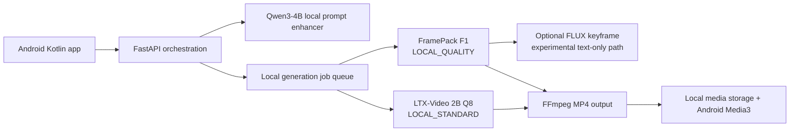

# Cretona zero-additional-spend video strategy

- **Document ID:** `CRETONA-FREE-LOCAL-001`
- **Mode:** Landscape/select
- **Observation date:** 2026-08-06
- **Decision owner:** Bruce and S0ra1n0
- **Status:** Ready for a local spike; no model has been downloaded or executed

## 1. Decision and definition of free

This brief identifies the highest-quality repeatable video strategy with no
API, subscription, trial-credit, or cloud-GPU payment. It assumes the team's
existing laptop is the inference host. Electricity, hardware wear, storage,
download bandwidth, and developer time still have a real cost; therefore the
accurate term is **zero additional cash spend**, not zero cost-to-serve.

The target is not the highest-scoring open-weight model on any hardware. It is
the best output that Cretona can repeatedly generate on the measured machine
without making the final demonstration dependent on an unowned cloud quota.

## 2. Measured host constraint

| Resource | Read-only observation | Consequence |
|---|---|---|
| GPU | NVIDIA RTX 3070 Ti Laptop, 8 GB VRAM, compute capability 8.6 | Ampere CUDA is supported, but 12-24 GB reference paths do not fit directly |
| System RAM | 15,629 MB total; about 1,959 MB available at observation time | Heavy CPU offload is the dominant risk; other applications must be closed before a spike |
| Storage | About 483.5 GB free on drive D | Enough for model weights, caches, intermediate frames and outputs |
| Operating system | Windows | Prefer maintained Windows packages and reversible local workers |

The GPU observation came from `nvidia-smi`; RAM and disk came from read-only
Windows system commands. Available RAM is transient and must be remeasured
immediately before testing.

## 3. Current model landscape bounded by this hardware

Quality ranks below are not interchangeable with local feasibility. Arena
scores describe human preference across outputs, not whether a model can run
on this laptop.

| Candidate | Published capability/quality evidence | Main hardware path | Fit on this laptop | Decision |
|---|---|---|---|---|
| MiniMax H3 | Ranked first among open-source text-to-video entries in the current Arena view; native video/audio claims | Fresh community reports start around 12 GB VRAM for a pruned path | Below known minimum and too new for a course-critical dependency | Exclude now |
| Kandinsky 5 Video Lite | Ranked second in the current open-source Arena view; 2B T2V/I2V family | Official repository says generation can run at 12 GB after optimization | 8 GB is below the documented path | Exclude now |
| HunyuanVideo 1.5 | Ranked third in the current open-source Arena view; official 8.3B T2V/I2V with 720p and a 1080p super-resolution stage | Official minimum is 14 GB VRAM with offload; the official repo links a community Wan2GP route reported as low as 6 GB | Best quality ceiling among plausible low-VRAM hacks, but 16 GB system RAM makes offload/paging high-risk | Challenger only; do not make it the MVP dependency |
| LTX-2 19B | Ranked fourth in the current open-source Arena view; synchronized audio/video and strong controls | Current LTX Desktop guidance treats Windows systems below 16 GB VRAM as API-only | Does not fit the zero-paid local boundary | Exclude now |
| Wan2.2 A14B/5B | Strong current open-weight benchmark history; T2V/I2V/TI2V variants | Practical 5B path is normally associated with about 24 GB VRAM; larger variants need more | Does not fit 8 GB without an unverified extreme-offload workflow | Exclude now |
| FramePack F1 | 13B Hunyuan-based I2V with anti-drifting; official implementation explicitly supports 6 GB VRAM, Windows and RTX 30-series laptops | Official author reports a 3070 Ti laptop at roughly 4-8 times the per-frame time of a 4090 | Fits VRAM and exact GPU family; system RAM and latency remain untested | Best **quality-mode** candidate |
| LTX-Video 2B distilled/Q8 | T2V and I2V, Apache-2.0 code plus version-specific open-weight license, 720x480x121 example; official repo reports under one minute on RTX 4060 8 GB for Q8 | Designed for 8 GB; Ampere 3070 Ti will not receive the exact Ada optimization result quoted for the 4060 | Best single-model balance for both selected input modes | Best **standard-mode** candidate |
| CogVideoX 2B | Apache-2.0 2B path and mature Diffusers support | Designed for older/smaller GPUs | Feasible but older and lower in independent open-video comparisons than stronger families | Fallback challenger |
| Wan2.1 T2V 1.3B | Apache-2.0 T2V model, 480p-class output, published 8.19 GB VRAM requirement | CPU offload is needed because the laptop exposes 8,192 MiB | Feasible only with tuning; text-only and not the best product fit | Baseline challenger, not the recommendation |

## 4. Recommended free architecture

Use a local two-profile strategy rather than forcing one model to optimize both
speed and visual ceiling.

### `LOCAL_STANDARD`

- Model: LTX-Video 2B v0.9.8 distilled/Q8.
- Inputs: text or one reference image.
- Target: 720x480, approximately 121 frames, short clip.
- Purpose: repeatable development, Android integration and live demonstration.
- Reason: it is the strongest documented one-model match for 8 GB VRAM and the
  complete Cretona input contract.

### `LOCAL_QUALITY`

- Model: FramePack F1 I2V.
- Input: one reference/keyframe image plus motion/camera prompt.
- Target: one short hero clip; duration capped during the spike.
- Purpose: highest visual-consistency mode when generation time is acceptable.
- Reason: it uses a 13B video model while the official implementation supports
  6 GB VRAM and explicitly discusses RTX 3070 Ti laptop performance.

### Text-only request in quality mode

FramePack is image-conditioned. For a text-only request, use one of these
bounded policies:

1. Stable MVP policy: route text-only requests to `LOCAL_STANDARD`.
2. Experimental quality policy: sequentially create a keyframe with
   quantized FLUX.1 Schnell, unload the image model, then animate it through
   FramePack.

The second policy may improve composition but adds a second large model and is
not accepted until it passes the RAM/latency spike. FLUX.1 Schnell is
Apache-2.0 and Diffusers documents quantization/offload for sub-16-GB systems;
exact 8-GB behavior on this laptop remains untested.

## 5. Fully local system boundary

Recommended components:

| Boundary | Technology | Why |
|---|---|---|
| Prompt LLM | Qwen3-4B quantized, served locally through Ollama or an OpenAI-compatible local server | Apache-2.0, 4B parameters, 100+ languages; FastAPI demonstrably calls an LLM without a paid or data-sharing API |
| Video worker | Separate Python process using the selected local pipeline | Allows FastAPI to remain responsive and the GPU worker to fail/restart independently |
| Job contract | Existing canonical `QUEUED/RUNNING/SUCCEEDED/FAILED/CANCELLED` model | Keeps Android independent from LTX/FramePack implementation details |
| Media | Local bounded directory plus SQLite metadata | No cloud storage bill; simple ownership and cleanup |
| Encoding | FFmpeg to H.264 MP4 | Broad Android Media3 compatibility |
| Test/demo fallback | Existing `FakeVideoProvider` | Deterministic tests and honest recovery when local inference is too slow |

Only one large model may be loaded at a time. The worker must explicitly unload
the prompt/image model and release CUDA memory before loading the video model.

## 6. Business scope achieved

| Capability | Free local result |
|---|---|
| FastAPI calls a real LLM | Yes, local Qwen3-4B |
| Prompt improvement and user approval | Yes |
| Text-to-video | Yes through LTX Standard; FramePack quality requires a generated or supplied keyframe |
| Reference-image-to-video | Yes through LTX and FramePack |
| Standard/Quality profiles | Yes, server-mapped and zero-price |
| Authentication, roles, ownership, quota and history | Unchanged from the SRS |
| Cost estimate | Replaced by estimated queue time, output size and local resource warning |
| Native generated audio | No in the recommended first free slice |
| Offline after initial downloads | Yes |
| Deterministic demo fallback | Yes |

## 7. Expected quality and honest limits

`LOCAL_STANDARD` should be treated as a usable short-video generator, not as a
free equivalent of current Veo/Kling premium output. Its main advantage is a
complete, repeatable contract on 8 GB VRAM.

`LOCAL_QUALITY` is expected to improve reference-image consistency and visual
detail because FramePack runs a much larger image-conditioned video model. It
may take many minutes for a five-second clip on the measured laptop. The
official author reports a 3070 Ti laptop can be four to eight times slower per
frame than a 4090; this is feasibility evidence, not a measured Cretona result.

Neither route currently provides synchronized native dialogue/audio. Adding a
separate local TTS or soundtrack is possible, but lip-sync and generated-audio
quality are out of the first free MVP.

## 8. Required bake-off before selection

Experiment ID: `EXP-005` — status `not-run`.

### Procedure

1. Close memory-heavy applications and record available RAM, VRAM and disk.
2. Use one synthetic 16:9 reference image and one English motion prompt.
3. Generate the closest comparable 4-5 second output with:
   - LTX-Video 2B distilled/Q8;
   - FramePack F1;
   - optional Wan2.1 1.3B baseline only if time remains.
4. Record install size, peak RAM/VRAM, wall-clock time, first-run failure,
   repeat-run success, output resolution and exact parameters.
5. Blind-score composition, motion coherence, prompt adherence, reference
   consistency and artifacts.

### Pass thresholds

- No OOM or OS instability across two consecutive runs.
- `LOCAL_STANDARD`: complete a short clip within 10 minutes and score at least
  65/100.
- `LOCAL_QUALITY`: complete a five-second-or-shorter clip within 30 minutes and
  beat Standard by at least 8 weighted points.
- Both outputs must encode to an H.264 MP4 playable through Android Media3.
- Total permanent model/cache footprint stays below 100 GB on drive D.

### Disconfirming and kill results

- If LTX exceeds 10 minutes or fails twice, test Wan2.1 only as a baseline and
  reconsider whether zero-paid live generation is demo-safe.
- If FramePack requires more than 30 minutes, exhausts system RAM, or improves
  the score by fewer than 8 points, remove `LOCAL_QUALITY` from the live MVP.
- Do not install HunyuanVideo 1.5, Kandinsky, Wan2.2 or LTX-2 solely because a
  community quantization claims 8-GB support; require a reproducible manifest
  and measured RAM boundary first.

## 9. Team split for the spike

| Owner | Work |
|---|---|
| S0ra1n0 | Build the isolated local worker spike, model lifecycle logging, cancellation and resource evidence |
| Bruce | Prepare the fixed prompt/reference asset, Android Media3 playback proof and blind scoring sheet |
| Both | Run two consecutive generations, score outputs without model labels and accept/reject each profile |

No Android or production FastAPI implementation should depend on a local model
until this spike has passed.

## 10. Licensing and safety boundary

- Qwen3-4B, FLUX.1 Schnell, FramePack software, and the LTX-Video code
  repository are documented under Apache-2.0.
- LTX-Video checkpoints use version-specific LTX Open Weights licenses. The
  exact 2B v0.9.8 distilled/Q8 license file must be retained and reviewed; the
  repository's Apache code license must not be incorrectly applied to weights.
- FramePack uses Hunyuan-derived model weights; the underlying Tencent Hunyuan
  community license and acceptable-use rules must also be retained and
  reviewed. It is not equivalent to Apache-2.0 and contains territory/use
  conditions.
- Use only synthetic prompts and reference images during the bake-off.
- Do not generate impersonation, sexual content involving minors, defamation,
  non-consensual imagery or copyrighted-character demo material.
- Store model source, version, license locator and output provenance with the
  experiment evidence.

## 11. Why free cloud GPU is not the selected backend

Kaggle currently documents free P100 access with a weekly quota, and Colab free
resources are not guaranteed. They are useful for one-off research, but they
do not provide an owned, durable service endpoint for the Android app and can
disconnect or change hardware. Trial credits are also not a sustainable free
architecture. They remain optional benchmark tools, not Cretona's backend.

## 12. Evidence

- Current open-source text-to-video Arena view, observed 2026-08-06:
  https://arena.ai/leaderboard/text-to-video?license=open-source
- FramePack official repository and 6-GB/3070-Ti statements:
  https://github.com/lllyasviel/framepack
- FramePack Diffusers documentation:
  https://huggingface.co/docs/diffusers/api/pipelines/framepack
- LTX-Video official repository, Q8 and 2B distilled details:
  https://github.com/Lightricks/LTX-Video
- HunyuanVideo 1.5 official repository and 14-GB reference minimum:
  https://github.com/Tencent-Hunyuan/HunyuanVideo-1.5
- HunyuanVideo 1.5 community license:
  https://github.com/Tencent-Hunyuan/HunyuanVideo-1.5/blob/main/LICENSE
- Kandinsky 5 official repository and 12-GB statement:
  https://github.com/kandinskylab/kandinsky-5
- Wan2.1 T2V 1.3B model card:
  https://huggingface.co/Wan-AI/Wan2.1-T2V-1.3B
- CogVideo official repository:
  https://github.com/zai-org/CogVideo
- FLUX.1 Schnell model card and license:
  https://huggingface.co/black-forest-labs/FLUX.1-schnell
- Qwen3-4B model card and license:
  https://huggingface.co/Qwen/Qwen3-4B
- Kaggle free GPU quota guidance:
  https://www.kaggle.com/docs/efficient-gpu-usage

## 13. Residual uncertainty

- No local model has been installed or run; quality, time and RAM remain
  unverified on this exact Windows image.
- The current 16-GB system RAM is materially below what many low-VRAM community
  workflows assume.
- Independent leaderboards do not include all quantized/distilled variants and
  do not measure this laptop.
- Model repositories, weights, licenses and recommended workflows can change.
