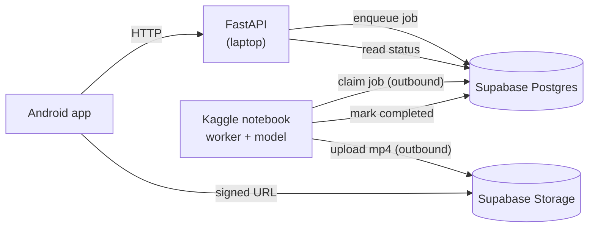

# Cretona — Kaggle GPU worker plan

- **Document ID:** `CRETONA-KAGGLE-WORKER-001`
- **Mode:** Implemented source contract; live Supabase/Kaggle acceptance pending
- **Written:** 2026-08-19
- **Status:** **UNBLOCKED 2026-08-27.** Kaggle generates real text-to-video
  with Wan2.1 T2V 1.3B via a two-phase load, **~49 min per 5-second clip**. See
  `docs/evidence/EXP-005_KAGGLE_T2V_WORKING_2026-08-27.md`. The worker,
  least-privilege migration and runbook now exist; the first live app-generated
  clip and blind quality decision remain open.
- **Related:** `ADR-009`, `FREE-LOCAL-BEST-OUTPUT.md` §11,
  `EXP-005_HOST_RECHECK_2026-08-19.md`

> **Unblocked, 2026-08-27.** This plan assumed Kaggle could supply the compute
> the laptop cannot. That was disconfirmed on 2026-08-23 and is now confirmed:
> the earlier failures were a loading strategy, not a hardware limit. Holding
> the text encoder and transformer together needs ~25 GB; loading them in two
> phases needs ~4 GB at peak, and the same T4s generate fine.
>
> **Measured, full run 2026-08-27** (`EVD-EXP005-011`): Wan2.1 T2V 1.3B,
> 4/4 clips and 4 distinct, 832x480, 81 frames, 5.06 s at 16 fps.
> **2901.9-2952.1 s per clip, mean 2918.8 s = 48.6 min**, peak 12.45 GiB VRAM
> and 29.13 GiB RAM of 31.35 available.
>
> **The earlier ~10.4 min figure was at 50 frames, and on a run later
> invalidated by the grey-clip bug.** 81 frames is 1.62x the frames for 4.7x
> the time — attention cost is superlinear in frame count, so clip length is
> the dominant latency lever, ahead of step count. Anything in this plan that
> assumed a ten-minute job needs re-checking against 49 minutes: a free Kaggle
> week is ~30 GPU-hours, which is **about 37 clips per week** for the whole
> team, and peak RAM leaves only ~2.2 GiB of headroom.
>
> **W1, W2, W3 source and W4 are complete.** W3 is not live-accepted until
> migration 014 is applied and one Android-submitted clip completes and plays.
>
> **One correction to §4 W3 below:** HunyuanVideo 1.5 remains rejected for this
> host. The implemented worker runs **Wan2.1 T2V 1.3B** and uses the measured
> two-phase load. It cannot keep encoder and generator resident together;
> cached prompt embeddings are the hand-off between phases.

## 1. The problem this solves

The laptop has 8 GB of VRAM. Every video model worth running needs more. Kaggle
gives 16 GB-class GPUs for free, which is enough — but Kaggle is a notebook
environment, not a server host:

- nothing can make an inbound connection to a Kaggle session;
- sessions end (roughly 9 hours, and a weekly GPU-hour quota);
- storage is wiped between sessions, so model weights are re-downloaded.

So the backend **cannot** be moved to Kaggle. The question is whether the
*generation step alone* can be, while the backend stays where it is.

`FREE-LOCAL-BEST-OUTPUT.md` §11 rejected free cloud GPU as *the backend*. This
proposal does not contradict that: Kaggle is never an endpoint here. It is a
worker that reaches out.

## 2. Why this became possible on 2026-08-19

Until today the database and media lived on the laptop (SQLite and
`backend/assets/`). A Kaggle session could not see either, so there was nothing
for the two halves to share.

Both are now on Supabase. That is the whole idea:

**Neither machine has to reach the other, because both can reach Supabase.**

The laptop cannot accept inbound connections. Kaggle cannot accept inbound
connections. Supabase accepts inbound connections from both. It becomes the
meeting point, and no tunnel, public URL, or ngrok is needed anywhere.

## 3. Architecture

Every arrow out of Kaggle is **outbound**. Nothing connects *into* it.

### What runs where

| Location | Runs | Exists today? |
|---|---|---|
| Android emulator/phone | the app | yes |
| Laptop | FastAPI backend | yes, unchanged |
| Supabase | Postgres + Storage | yes, live since 2026-08-19 |
| **Kaggle** | **worker loop + the video model** | **source complete; live credentials/run pending** |

The FastAPI backend is **not** deployed to Kaggle. It stays on the laptop
exactly as it runs now.

### Job lifecycle

1. App submits a prompt. FastAPI creates the project row with
   `status='pending'`, `provider='kaggle'`, and returns immediately.
2. The Kaggle worker polls Postgres, claims one `pending` row by taking a
   lease, and sets `status='generating'`.
3. The worker runs the model, writing `progress_percent` and `step_message` as
   it goes. The app's existing polling shows these with no client change.
4. The worker uploads the finished mp4 to Supabase Storage at the canonical
   path `{user_id}/{project_id}/video.mp4`.
5. The worker sets `status='completed'`, `video_path=...`, and releases the
   lease.
6. The app polls, FastAPI reads the row, and returns a signed URL.

## 4. What has to be built

Four work items. Ordered so each is independently testable.

### W1 — Provider-scoped job claiming *(backend, small)*

**The problem:** `claim_in_flight_projects` claims any row with status
`pending` or `generating`, regardless of `provider`. The in-process
`JobPoller` on the laptop would therefore claim the same rows the Kaggle
worker wants, and try to generate them itself with a provider that cannot.

Whoever claims first wins the lease and the other waits — so jobs would be
served late, erratically, or by the wrong machine.

**The change:** add a provider filter to `claim_in_flight_projects` on both
adapters (`database.py` and `postgres.py`), so:

- the laptop `JobPoller` claims only providers it can execute in-process
  (`fake`, `cloud`, `local`);
- the Kaggle worker claims only `provider = 'kaggle'`.

Two claimants, disjoint sets, no contention. This is the one change that makes
the rest safe, and it should land first.

### W2 — An `external` provider mode *(backend, small)*

Today generation happens *inside* the FastAPI process: the poller claims a
lease and calls the provider's `poll()` in-process. An external worker
inverts that.

Add a provider to `ProviderRegistry` whose:

- `submit()` only records the job — no work, no network;
- `poll()` reads the row's current status rather than contacting anything.

Register it under `kaggle`. `VideoProvider` is a Protocol, so this is a new
class implementing the existing interface; no call site changes.

The Android wire contract does not change. ADR-009's provider-neutrality
guarantee holds.

### W3 — The worker itself *(source complete; live acceptance pending)*

A single Python file, run in a Kaggle notebook cell. Loop:

1. Claim one `pending` row where `provider='kaggle'`, taking a lease.
2. Set `status='generating'`.
3. Run the model (**Wan2.1 T2V 1.3B**, not HunyuanVideo 1.5 — Hunyuan's
   transformer alone is ~16.6 GB in fp16, above a single T4, and the two-phase
   split does not rescue it). Text-to-video only until an I2V candidate passes
   its own gate.
4. Update `progress_percent` / `step_message` periodically.
5. Upload the mp4 to Supabase Storage.
6. Set `status='completed'` and `video_path`; release the lease.
7. On failure, set `status='failed'` with an `error_code` from the existing
   vocabulary and release the lease.

It must reuse the existing lease columns (`lease_owner`, `lease_expires_at`)
and honour `transitions.py` — the same `pending → generating → completed`
rules the backend enforces. A worker that writes an illegal transition will
desynchronise the app's state machine.

**Heartbeat:** the lease has to be extended while a long generation runs, or it
expires mid-job and the row is handed to another claimant. The measured job is
**2918 s**, and `poll_lease_seconds` defaults to **120** with a validator
ceiling of **3600** (`backend/app/config.py`). At the default a single clip
would be re-claimed roughly 24 times; even the maximum leaves only ~11 minutes
of margin over the slowest observed clip. Renewing on a timer is therefore
required, not an optimisation, and the worker must renew rather than rely on a
long initial lease.

**Two-phase memory:** the measured host does not have enough RAM to keep the
22.7 GB text encoder and generator resident together. The worker caches each
project's embeddings, frees the encoder, runs the generator, then frees the
generator before the next uncached prompt. This spends extra load time but
preserves the only memory profile proven on the 31.35 GiB Kaggle host.

**Progress reporting:** at 49 minutes per clip, `progress_percent` is what
stops the app looking hung. Report per denoising step — 50 steps is roughly one
update a minute.

### W4 — Image input plumbing *(complete for image-capable providers)*

The app, API, storage and `real`/`local` providers preserve and consume the
reference image. The Wan2.1 worker is intentionally text-only and the backend
rejects image/image+text requests before charging; an actual I2V model remains
stretch scope rather than silently discarding the image.

## 5. Security — read this before writing any credentials

The worker needs to reach Supabase Postgres and Storage from a Kaggle
notebook. **Do not put the `service_role` key in the notebook.**

That key bypasses row-level security entirely and is full administrative
access to the project. A Kaggle notebook is an environment you do not control,
can be made public by accident, and its outputs are saved.

Instead:

- create a **dedicated Postgres role** for the worker, granted only
  `SELECT`/`UPDATE` on `public.video_projects` and nothing else;
- create a **scoped storage credential** limited to the `videos` bucket;
- store both in **Kaggle Secrets**, never in a cell;
- keep the notebook **private**;
- be able to revoke both without touching the app's own credentials.

If a worker credential leaks, the blast radius should be "someone could mark
jobs complete", not "someone owns the database".

## 6. Failure modes, and why the design survives them

| Failure | What happens |
|---|---|
| Kaggle session ends mid-generation | The lease expires; the row returns to `pending` and is picked up by the next session. Nothing is lost or stuck. |
| No worker is running | Jobs sit at `pending`. The app shows them queued. Nothing breaks; nothing completes. |
| Worker crashes after upload, before marking complete | The file is in Storage, the row is still `generating`. The lease expires and the job is retried — the upload overwrites at the same deterministic path. |
| Two workers run at once | `SKIP LOCKED` plus the lease means they claim disjoint rows. Safe by construction. |
| Weekly GPU quota exhausted | Generation stops. Everything else in the app keeps working. |

The lease behaviour is not new — it already protects the in-process poller.
The worker inherits it.

## 7. Honest limits

This is **not** a service, and should never be described as one:

- generation only happens while a human has a notebook running;
- roughly 30 GPU-hours per week, and at a **measured 48.6 min per 5-second
  clip** that is **about 37 clips per week** for the entire team;
- ~30–40 GB of model weights re-downloaded each session, which consumes a
  meaningful part of the runtime before the first clip;
- first-clip latency after a cold session start is minutes, not seconds, and
  the clip itself is then **another ~49 minutes**. A user who submits a prompt
  waits the better part of an hour;
- peak RAM was 29.13 GiB of 31.35 available, leaving ~2.2 GiB. Running the
  worker loop alongside the model is not free, and this is the constraint that
  broke the 2026-08-23 attempts.

It is good enough for a demo, a bake-off, and a recorded walkthrough. It is not
good enough for real users, and the README should say so.

## 8. Remaining sequence

W1–W4 are complete in source. The remaining order is deliberately short:

1. Apply and verify migration 014.
2. Create the dedicated database/Auth worker identities and Kaggle Secrets.
3. Run S-14: submit from Android, generate, upload, complete, and play the MP4.
4. Score the blind EXP-005 clips and record the team's quality decision.

Stop and preserve evidence if the worker cannot renew its lease, exceeds the
measured memory envelope, cannot upload under the scoped Storage policy, or
produces output the team rates below the accepted quality threshold. Do not
work around those failures with `service_role` or broader table grants.
