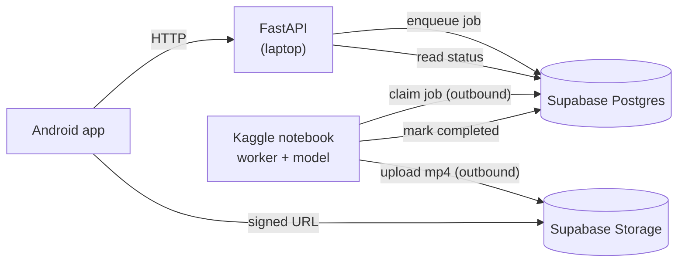

# Cretona — Kaggle GPU worker plan

- **Document ID:** `CRETONA-KAGGLE-WORKER-001`
- **Mode:** Design proposal; nothing here is built
- **Written:** 2026-08-19
- **Status:** Proposal — **do not build until EXP-005 produces a scored clip**
- **Related:** `ADR-009`, `FREE-LOCAL-BEST-OUTPUT.md` §11,
  `EXP-005_HOST_RECHECK_2026-08-19.md`

## 1. The problem this solves

The laptop has 8 GB of VRAM. Every video model worth running needs more. Kaggle
gives 16 GB-class GPUs for free, which is enough — but Kaggle is a notebook
environment, not a server host:

- nothing can make an inbound connection to a Kaggle session;
- sessions end (roughly 9 hours, and a weekly GPU-hour quota);
- storage is wiped between sessions, so model weights are re-downloaded.

So the backend **cannot** be moved to Kaggle. The question is whether the
*generation step alone* can be, while the backend stays where it is.

`FREE-LOCAL-BEST-OUTPUT.md` §11 rejected free cloud GPU as *the backend*. This
proposal does not contradict that: Kaggle is never an endpoint here. It is a
worker that reaches out.

## 2. Why this became possible on 2026-08-19

Until today the database and media lived on the laptop (SQLite and
`backend/assets/`). A Kaggle session could not see either, so there was nothing
for the two halves to share.

Both are now on Supabase. That is the whole idea:

**Neither machine has to reach the other, because both can reach Supabase.**

The laptop cannot accept inbound connections. Kaggle cannot accept inbound
connections. Supabase accepts inbound connections from both. It becomes the
meeting point, and no tunnel, public URL, or ngrok is needed anywhere.

## 3. Architecture

Every arrow out of Kaggle is **outbound**. Nothing connects *into* it.

### What runs where

| Location | Runs | Exists today? |
|---|---|---|
| Android emulator/phone | the app | yes |
| Laptop | FastAPI backend | yes, unchanged |
| Supabase | Postgres + Storage | yes, live since 2026-08-19 |
| **Kaggle** | **worker loop + the video model** | **no — this is the new piece** |

The FastAPI backend is **not** deployed to Kaggle. It stays on the laptop
exactly as it runs now.

### Job lifecycle

1. App submits a prompt. FastAPI creates the project row with
   `status='pending'`, `provider='kaggle'`, and returns immediately.
2. The Kaggle worker polls Postgres, claims one `pending` row by taking a
   lease, and sets `status='generating'`.
3. The worker runs the model, writing `progress_percent` and `step_message` as
   it goes. The app's existing polling shows these with no client change.
4. The worker uploads the finished mp4 to Supabase Storage at the canonical
   path `{user_id}/{project_id}/video.mp4`.
5. The worker sets `status='completed'`, `video_path=...`, and releases the
   lease.
6. The app polls, FastAPI reads the row, and returns a signed URL.

## 4. What has to be built

Four work items. Ordered so each is independently testable.

### W1 — Provider-scoped job claiming *(backend, small)*

**The problem:** `claim_in_flight_projects` claims any row with status
`pending` or `generating`, regardless of `provider`. The in-process
`JobPoller` on the laptop would therefore claim the same rows the Kaggle
worker wants, and try to generate them itself with a provider that cannot.

Whoever claims first wins the lease and the other waits — so jobs would be
served late, erratically, or by the wrong machine.

**The change:** add a provider filter to `claim_in_flight_projects` on both
adapters (`database.py` and `postgres.py`), so:

- the laptop `JobPoller` claims only providers it can execute in-process
  (`fake`, `cloud`, `local`);
- the Kaggle worker claims only `provider = 'kaggle'`.

Two claimants, disjoint sets, no contention. This is the one change that makes
the rest safe, and it should land first.

### W2 — An `external` provider mode *(backend, small)*

Today generation happens *inside* the FastAPI process: the poller claims a
lease and calls the provider's `poll()` in-process. An external worker
inverts that.

Add a provider to `ProviderRegistry` whose:

- `submit()` only records the job — no work, no network;
- `poll()` reads the row's current status rather than contacting anything.

Register it under `kaggle`. `VideoProvider` is a Protocol, so this is a new
class implementing the existing interface; no call site changes.

The Android wire contract does not change. ADR-009's provider-neutrality
guarantee holds.

### W3 — The worker itself *(new, the bulk of the effort)*

A single Python file, run in a Kaggle notebook cell. Loop:

1. Claim one `pending` row where `provider='kaggle'`, taking a lease.
2. Set `status='generating'`.
3. Run the model (HunyuanVideo 1.5 — T2V or I2V depending on whether
   `image_path` is set).
4. Update `progress_percent` / `step_message` periodically.
5. Upload the mp4 to Supabase Storage.
6. Set `status='completed'` and `video_path`; release the lease.
7. On failure, set `status='failed'` with an `error_code` from the existing
   vocabulary and release the lease.

It must reuse the existing lease columns (`lease_owner`, `lease_expires_at`)
and honour `transitions.py` — the same `pending → generating → completed`
rules the backend enforces. A worker that writes an illegal transition will
desynchronise the app's state machine.

**Heartbeat:** the lease has to be extended while a long generation runs, or it
expires mid-job and the row is handed to another claimant.

### W4 — Image-to-video input *(backend, blocking for I2V)*

Every provider's `submit()` begins `del image_path`, so the uploaded reference
image is discarded. Until that is wired through, the worker cannot receive an
image and only text-to-video is possible.

Independent of Kaggle; needed by any real provider.

## 5. Security — read this before writing any credentials

The worker needs to reach Supabase Postgres and Storage from a Kaggle
notebook. **Do not put the `service_role` key in the notebook.**

That key bypasses row-level security entirely and is full administrative
access to the project. A Kaggle notebook is an environment you do not control,
can be made public by accident, and its outputs are saved.

Instead:

- create a **dedicated Postgres role** for the worker, granted only
  `SELECT`/`UPDATE` on `public.video_projects` and nothing else;
- create a **scoped storage credential** limited to the `videos` bucket;
- store both in **Kaggle Secrets**, never in a cell;
- keep the notebook **private**;
- be able to revoke both without touching the app's own credentials.

If a worker credential leaks, the blast radius should be "someone could mark
jobs complete", not "someone owns the database".

## 6. Failure modes, and why the design survives them

| Failure | What happens |
|---|---|
| Kaggle session ends mid-generation | The lease expires; the row returns to `pending` and is picked up by the next session. Nothing is lost or stuck. |
| No worker is running | Jobs sit at `pending`. The app shows them queued. Nothing breaks; nothing completes. |
| Worker crashes after upload, before marking complete | The file is in Storage, the row is still `generating`. The lease expires and the job is retried — the upload overwrites at the same deterministic path. |
| Two workers run at once | `SKIP LOCKED` plus the lease means they claim disjoint rows. Safe by construction. |
| Weekly GPU quota exhausted | Generation stops. Everything else in the app keeps working. |

The lease behaviour is not new — it already protects the in-process poller.
The worker inherits it.

## 7. Honest limits

This is **not** a service, and should never be described as one:

- generation only happens while a human has a notebook running;
- roughly 30 GPU-hours per week;
- ~30–40 GB of model weights re-downloaded each session, which consumes a
  meaningful part of the runtime before the first clip;
- first-clip latency after a cold session start is minutes, not seconds.

It is good enough for a demo, a bake-off, and a recorded walkthrough. It is not
good enough for real users, and the README should say so.

## 8. Sequencing, and the decision that comes first

**Do not start W1–W4 yet.**

All of this is wasted if HunyuanVideo 1.5's output is not worth shipping. The
cheap step first:

1. **Run the model manually on Kaggle.** A notebook, a few prompts, look at the
   clips. This is the EXP-005 bake-off (`FREE-LOCAL-BEST-OUTPUT.md` §8), and
   §11 explicitly permits Kaggle for one-off research.
2. **Score the output** against the existing quality gate.
3. **Only if it passes**, build W1 → W2 → W4 → W3.

W1 and W2 are small and low-risk. W3 is the bulk. W4 is required for
image-to-video and useful regardless of which provider ever wins.

### What would kill this proposal

- the model output is not visibly better than the current still-pan placeholder;
- weight download consumes so much of each session that throughput is unusable;
- the Hunyuan weight licence forbids the redistribution the demo needs
  (`FREE-LOCAL-BEST-OUTPUT.md` §10 records this as unresolved).

Any of those is a valid result and should be recorded as evidence, not worked
around.
