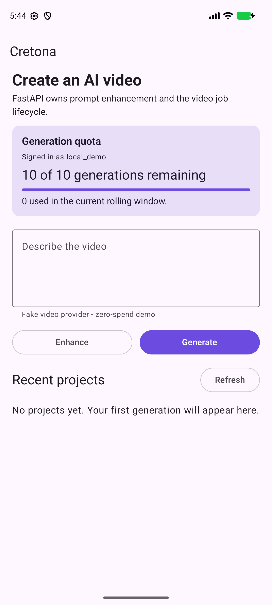
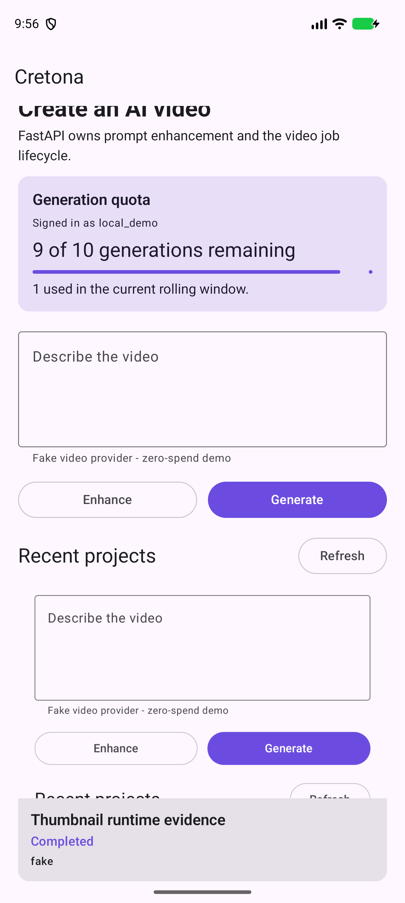

# Android to FastAPI vertical-slice evidence

**Executed:** 2026-08-10  
**Profile:** local development, zero additional cash spend  
**Result:** PASS within the evidence boundary below

## B-8 quota surface — 2026-08-12

The same `Pixel_10_Pro_XL` AVD cold-started package
`com.cretona.app.debug` against a dedicated local FastAPI/SQLite QA profile.
Android called `GET /api/v1/me` through `10.0.2.2`, then rendered the returned
identity and rolling quota **before** the prompt and Generate action:

- profile: `local_demo`;
- quota: `10 of 10 generations remaining`, `0 used`;
- Generate remained enabled because quota was available;
- the card, prompt, both actions, history heading, and empty state fit the
  compact portrait viewport without horizontal clipping.



Supporting gates for this increment: 12 Android unit tests, 0 failures/errors;
`lintDebug` passed; `assembleDebug` passed. Unit coverage includes loading the
profile, the username-to-email display fallback, post-submit quota refresh,
confirmed exhaustion blocking a repository call, and `/me` failure remaining
recoverable without inventing a client-side lockout.

The AVD used a deliberately seeded local development profile and contains no
Supabase credential. This is observed Android → FastAPI integration evidence,
not live Supabase Auth/Postgres evidence. The happy path is visually observed;
exhausted and network-error states are contract/unit evidence, not screenshots.

## B-9 history thumbnails — 2026-08-12

The `Pixel_10_Pro_XL` AVD then loaded a completed project's real
`thumbnailUrl` from the local FastAPI media route through Coil 3.5 and rendered
it above the history metadata. The screenshot uses the previous B-8 evidence
image as a deliberate local media fixture, which makes the successful image
load visually distinguishable from the neutral `Preview unavailable` fallback.



The implementation preserves the API's `16:9`, `9:16`, and `1:1` project
aspect ratios instead of forcing every preview into a landscape crop. Completed
projects with a null or failed URL keep their title, status, and provider and
show `Preview unavailable`; loading displays a bounded progress indicator.
`AsyncImage` is used rather than subcomposition inside the lazy history list.

Supporting gates after the aspect-ratio fix: 12 Android unit tests, 0
failures/errors; `lintDebug` passed; `assembleDebug` passed. The runtime media
fixture and SQLite database were temporary and removed after capture.

## Proven journey

On the `Pixel_10_Pro_XL` Android emulator, package
`com.cretona.app.debug` connected to FastAPI through
`http://10.0.2.2:8000/api/v1/` and completed this journey:

1. FastAPI health returned `ok`.
2. Android requested prompt enhancement and displayed the enhanced text.
3. The UI explicitly displayed `Deterministic fallback (no live LLM)`.
4. Android created a project, polled `pending -> generating -> completed`, and
   displayed the completed item in history.
5. Android Media3 opened the returned H.264/AAC MP4 in the player.
6. The software keyboard was dismissed after the actions.

Automation assertions at the terminal state:

```text
health=ok
enhancement=true
completed=true
player=true
history=true
imeStillShown=false
```


## Supporting gates

| Surface | Executed result |
|---|---|
| FastAPI tests | 19 passed after adding the production/dev-auth fail-closed regression gate |
| FastAPI Ruff | passed |
| Android unit tests | 7 passed, 0 failures/errors |
| Android lint | passed |
| Android debug assembly | passed; APK 24,318,568 bytes (about 24.32 MB decimal) |
| Media fixture | H.264 640x360 + AAC, 3 seconds, 235,690 bytes |
| Express reference regression | 77 tests passed; typecheck and build passed |

## Evidence boundary

- The MP4 is a committed synthetic color/test-pattern fixture. It is not the
  output of LTX-Video, FramePack, Gemini/Veo, OpenAI, Kling, Runway, or any
  other AI model.
- Prompt enhancement used the deterministic fallback in this device run. No
  live Ollama, ChatGPT, Gemini, or other LLM call is claimed.
- Development identity injection proves owner-scoped behavior locally; it does
  not prove deployed Supabase JWT verification.
- SQLite proves persistence across API requests; it does not prove Postgres
  concurrency, Supabase RLS, or restart-safe distributed workers.
- Real local video feasibility and quality remain blocked on `EXP-005`.

This evidence is suitable for protecting the working vertical slice while the
two developers add real-model and production-profile capabilities. It must not
be relabelled as proof of AI video quality.
