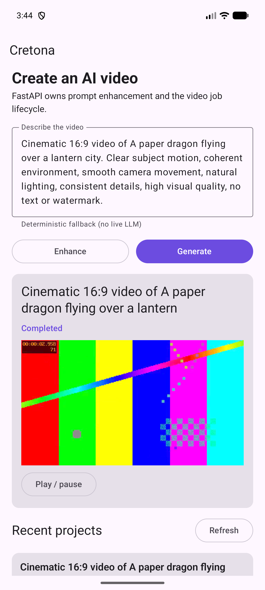

# Android to FastAPI vertical-slice evidence

**Executed:** 2026-08-10  
**Profile:** local development, zero additional cash spend  
**Result:** PASS within the evidence boundary below

## Proven journey

On the `Pixel_10_Pro_XL` Android emulator, package
`com.cretona.app.debug` connected to FastAPI through
`http://10.0.2.2:8000/api/v1/` and completed this journey:

1. FastAPI health returned `ok`.
2. Android requested prompt enhancement and displayed the enhanced text.
3. The UI explicitly displayed `Deterministic fallback (no live LLM)`.
4. Android created a project, polled `pending -> generating -> completed`, and
   displayed the completed item in history.
5. Android Media3 opened the returned H.264/AAC MP4 in the player.
6. The software keyboard was dismissed after the actions.

Automation assertions at the terminal state:

```text
health=ok
enhancement=true
completed=true
player=true
history=true
imeStillShown=false
```



## Supporting gates

| Surface | Executed result |
|---|---|
| FastAPI tests | 19 passed after adding the production/dev-auth fail-closed regression gate |
| FastAPI Ruff | passed |
| Android unit tests | 7 passed, 0 failures/errors |
| Android lint | passed |
| Android debug assembly | passed; APK 24,318,568 bytes (about 24.32 MB decimal) |
| Media fixture | H.264 640x360 + AAC, 3 seconds, 235,690 bytes |
| Express reference regression | 77 tests passed; typecheck and build passed |

## Evidence boundary

- The MP4 is a committed synthetic color/test-pattern fixture. It is not the
  output of LTX-Video, FramePack, Gemini/Veo, OpenAI, Kling, Runway, or any
  other AI model.
- Prompt enhancement used the deterministic fallback in this device run. No
  live Ollama, ChatGPT, Gemini, or other LLM call is claimed.
- Development identity injection proves owner-scoped behavior locally; it does
  not prove deployed Supabase JWT verification.
- SQLite proves persistence across API requests; it does not prove Postgres
  concurrency, Supabase RLS, or restart-safe distributed workers.
- Real local video feasibility and quality remain blocked on `EXP-005`.

This evidence is suitable for protecting the working vertical slice while the
two developers add real-model and production-profile capabilities. It must not
be relabelled as proof of AI video quality.
